# Benchmark: validating the simulation engine

KiriSMILES ships an open-source simulation engine, built on FEniCSx, for any design the notation
describes. This document records how that engine is validated.

The reference is
[*Kirigami Actuators*](https://pubs.rsc.org/sm/article-abstract/13/48/9087/585682/Kirigami-actuators)
(Dias, McCarron, Rayneau-Kirkhope, Hanakata, Campbell, Park and Holmes, *Soft Matter* **13**, 9087
(2017)), co-authored by this project's maintainer. The engine reproduces its finite-element results,
computed there with COMSOL, using the paper's material and boundary conditions:
- the single cut (Fig. 2);
- two interacting cuts (Fig. 3);
- the pitch, roll and yaw actuators (Figs. 4–5), with animations of each.

The paper's PET sheet is the engine's default material for that reason. Material and loading are
inputs, not fixed choices: specs can set any E, ν and h, and the roller, biaxial and in-plane
loading modes are checked on rotating-squares kirigami
([below](#rotating-squares-loading-modes-and-thickness)).

## Models

Two plate/shell models are used. Both are written in UFL and solved with FEniCSx 0.9.

- **Föppl–von Kármán plate** (`kirigami/fvk.py`): used for the single-cut study (Fig. 2),
  where rotations are moderate.
  - The in-plane displacement uses P2 elements.
  - The deflection uses P2 with a C0 interior-penalty (CIP) discretisation of the bending
    energy, so plain Lagrange elements suffice.
- **Geometrically exact Kirchhoff–Love shell** (`kirigami/shell.py`): used for every
  multi-cut configuration, whose rotations reach 25–55°.
  - Full 3D displacement field.
  - Green–Lagrange membrane strain.
  - Curvature measured with the deformed unit normal.
  - The same CIP treatment of bending.
  - On the single cut its largest deflection agrees with the FvK model to within 1% up to
    δ₀ ≈ 3 mm and 4% up to δ₀ ≈ 5.5 mm (lip tilt ≈ 8°). Beyond that FvK overestimates it:
    by 7% at Δ = 1 mm and 38% at Δ = 10 mm (23 mm against 14 mm; `single_cut_long` in
    `scripts/run_config.py`). Use FvK for the single cut only up to moderate deflections.

**Cuts.** `kirigami/geometry.py` builds the sheet with gmsh in two ways:
- *Zero-width slits* are embedded lines whose nodes are duplicated with gmsh's Crack plugin.
  This handles interior cracks and edge cracks.
- *Slots and windows* are boolean holes. Narrow slots are used where slits meet in
  T-junctions, which the Crack plugin can't split.

**Material.** Isotropic and elastic, set per spec (`material`: `E`, `nu`, `h`). The
*Kirigami Actuators* benchmark uses the paper's PET: E = 3.5 GPa, ν = 0.38, h = 0.127 mm, which
is also the default. Units are mm, MPa and N.

**Boundary conditions.** The sheet is stretched by Δ along x; `boundary.type` in the spec sets
how its edges are held.

| `type` | Edges | Out of plane |
|---|---|---|
| `clamped` (default) | x = 0 fixed; x = L displaced by (Δ, 0, 0) | no rotation at either end: ∂w/∂n = 0, imposed weakly with Nitsche terms |
| `roller` | x = 0 and x = L move only along x (by 0 and Δ), free to slide in y; one point pinned in y | ends simply supported (w = 0), free to rotate |
| `biaxial` | x = 0, L move by ∓Δ/2 along x; y = 0, W by ∓ΔW/(2L) along y; all edges free to slide along themselves | edges simply supported |

The *Kirigami Actuators* benchmark uses `clamped`, which follows the paper's Methods.

With `boundary.in_plane = true`, w = 0 everywhere and the bending energy is dropped. The model is
then a plane-stress membrane, the analogue of the plane calculations used for rotating-unit
kirigami, and it cannot buckle.

The MCP tool `start_simulation` exposes the same settings (`boundary`, `in_plane`,
`thickness_mm`, `E_MPa`, `nu`).

**Post-buckling.** In-plane runs skip steps 1–3.
1. Linear buckling of the stretched flat sheet gives Δ_c and the first mode.
2. That mode is applied as a tiny transverse imperfection.
3. On the first step past Δ_c, the solve starts from the mode at an amplitude of
   ~√(ℓ(Δ − Δ_c)). Without this, Newton tends to stay on the unstable flat branch.
4. Newton continuation follows, with step bisection.

## Mesh

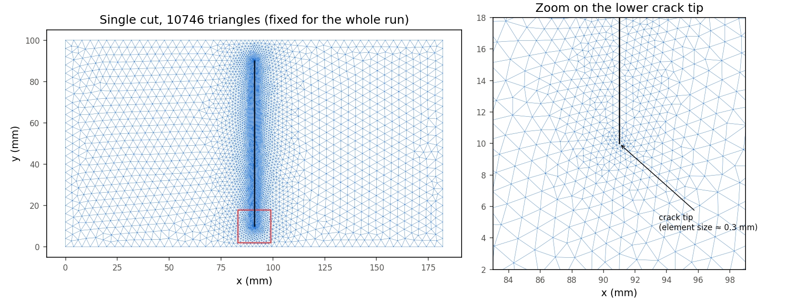

**When it is made.** The mesh is generated **once, before any load is applied**, and stays
fixed for the whole simulation. There is no remeshing and no adaptive refinement during a run.

**How deformation is described.** The formulation is *total Lagrangian*:
- The mesh describes the flat, undeformed sheet (the reference configuration).
- The unknowns are the displacements of its nodes.
- As the sheet stretches and buckles, every triangle moves and deforms with the material,
  which is what the GIFs show.
- The number of triangles and their connectivity never change.

**What kind of mesh.** An unstructured triangular mesh from gmsh's Frontal-Delaunay
algorithm (`Mesh.Algorithm = 6`):
- The triangles are straight-sided, with 3 nodes each.
- The displacement fields on them are quadratic (P2), with 6 values per triangle for each
  field component.
- "Unstructured" means the triangles follow the geometry instead of a regular grid, so cuts,
  slots and curved arms can sit anywhere.

**Why the triangles are small around the cuts.** The refinement is decided **in advance**,
from the geometry alone (*a priori* grading). gmsh is given a *mesh-size field*, a function
saying how big triangles should be at each point (`kirigami/geometry.py`):

| Where | Target element size | Rule |
|---|---|---|
| Along every cut and hole edge | `h_cut` | grows linearly to `h_far` between distances `d_min` and `d_max` from the cut |
| At every crack tip | `h_cut / 2` | grows to `h_far` between 0.5 and 10 mm from the tip |
| Everywhere else | `h_far` | |

gmsh uses the smallest of these targets at each point. For the single cut, with
`h_cut` = 0.5 and `h_far` = 4 mm, the mean element edge is 0.33 mm within 1 mm of a tip,
0.53 mm along the cut, and 4.1 mm far from it.

The fine elements go where the solution changes fastest:
- the stress concentration at the crack tips;
- the compressive zone and the buckled bump next to the cut;
- the sharp bending at the cut lips.

Far from the cuts the sheet is almost uniformly stretched, so large elements suffice. A
uniformly fine 0.35 mm mesh would need about 300,000 triangles; the graded one needs about
11,000.

**Is a fixed mesh good enough?** Yes, for these problems:
- *The fine regions never move.* The cuts and tips sit at fixed positions in the reference
  sheet, and the large gradients stay there at every load level.
- *It was checked.* Refining from `h_cut` = 0.35 to 0.18 mm changes the critical force by
  0.25% (`results/single_cut/convergence.csv`).
- *The weak spot.* Features that form *away* from the cuts are only resolved at the coarser
  size there, for example the kinks in the yaw actuator's frame strips. That is why the
  multi-cut configurations use `h_far` = 3 mm.

**How cuts enter the mesh.** Each cut line is embedded in the surface, so triangle edges run
exactly along it. Then the nodes on it are **duplicated** (gmsh's Crack plugin): one copy for
the triangles on each side, so the two lips can separate. Crack tips stay single nodes.
Junctions of slits and large openings are cut out as holes instead.

| Configuration | `h_cut` / `h_far` (mm) | Triangles |
|---|---|---|
| Single cut (shell check), two cuts | 0.5 / 4 | 10.7k–12.0k |
| Pitch cells | 0.8 / 3 | 8.8k |
| Roll | 0.6 / 3 | 11.2k |
| Yaw | 0.7 / 3 | 6.8k |

To preview any mesh, run `scripts/preview_mesh.py <name>` in the container, then
`python scripts/preview_mesh.py --plot <name>` on the host.

## Running

FEniCSx runs in Docker (`dolfinx/dolfinx:v0.9.0`). Plotting and GIFs use the host Python
(numpy, matplotlib, Pillow).

```bash
# Fig. 2 (FvK model)
./run.sh python3 -u scripts/single_cut_buckling.py                 # Fig 2a, 2c + mesh convergence
./run.sh python3 -u scripts/single_cut_postbuckling.py 0.127 80    # Fig 2b, 2d  (h b pairs)
python scripts/plot_single_cut.py

# Multi-cut configurations (KL shell): names are defined in scripts/run_config.py
./run.sh python3 -u scripts/run_config.py two_cuts_ls10 two_cuts_ls30 pitch_concave pitch_convex roll yaw
python scripts/make_gif.py two_cuts_ls10 pitch_concave roll yaw    # -> results/configs/*.gif
python scripts/plot_configs.py                                     # -> results/configs/fig*.png

# Rotating squares: loading modes, thickness and hinge width (specs/rs_thickness/)
for s in specs/rs_thickness/*.json; do python scripts/kirigami_cli.py simulate "$s"; done
python scripts/plot_rotating_squares.py                            # -> results/rotating_squares/
```

- **Memory.** Run one configuration at a time. A solve of about 10k–90k triangles needs
  1–2 GB. The finest rotating-squares mesh (200k triangles, 0.125 mm at the cuts) needs close
  to 3 GB.
- **Long runs** can go in a detached container (`docker run -d ...`) that writes to
  `logs/`.
- **Interrupted runs.** `run_config.py` saves its history after every load step, so an
  interrupted run still leaves results to plot.

## Results

### Single cut (Fig. 2)

| | |
|:---:|:---:|
| 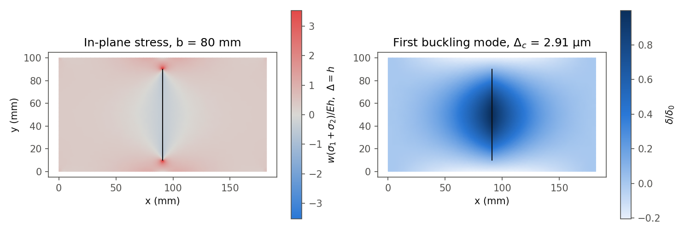 | 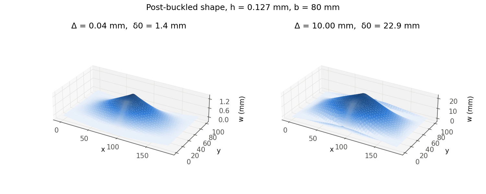 |
| 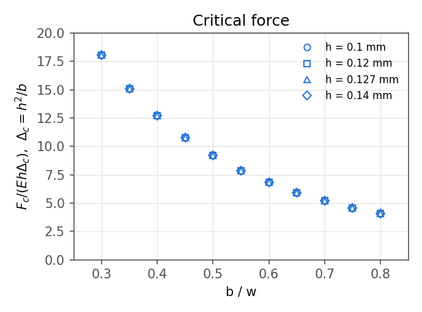 | 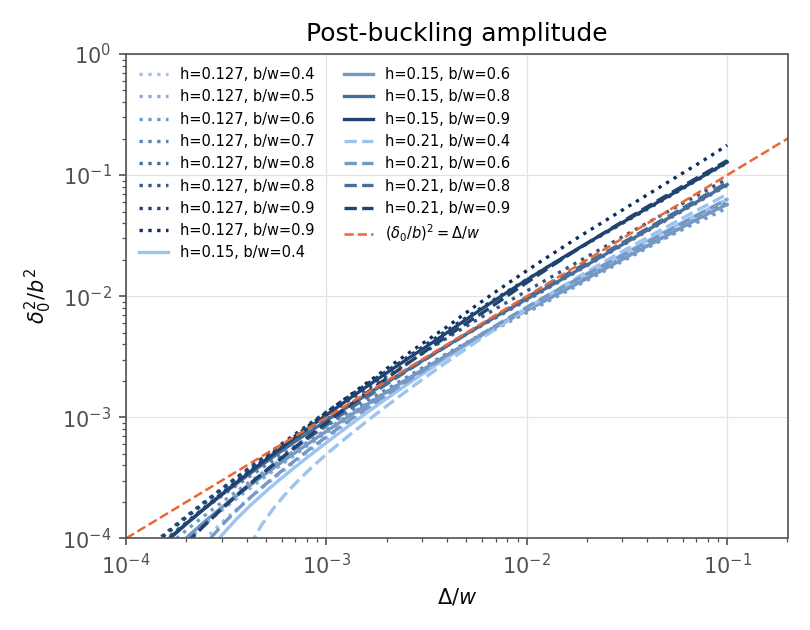 |

- **In-plane state (2a).** A compressive lens forms on both sides of the cut, with tension
  concentrated at the tips. A cut of b/w = 0.8 halves the sheet's stiffness.
- **First buckling mode.** It is symmetric: both sides of the cut lift together, as the
  paper assumes. The antisymmetric mode needs about 1.6× more stretch.
- **Critical force (2c).** F_c/(EhΔ_c) with Δ_c = h²/b falls from about 18 at b/w = 0.3 to 4
  at 0.8. The paper's curve goes from about 20 to 5. All four thicknesses fall on one curve,
  which is exact in a linear buckling analysis (the threshold scales exactly as h²).
- **Thickness is only a scale in the FvK model.** With u ~ h² and w ~ h the energy becomes
  independent of h, so Δ_c ∝ h² exactly and the post-buckled shapes are self-similar (the
  runs at h = 0.127, 0.15, 0.21 mm give the same δ₀/h at the same Δ/h² to within 0.4%).
  Collapses over thickness are therefore built in; what the model tests is the dependence
  on b/w and L/w.
- **Sheet proportions** (`scripts/single_cut_shape_sweep.py`, `shape_sweep.csv`; b/w =
  0.3–0.8, L/w = 0.6–3.5). The critical force becomes independent of L for L/w ≳ 2 (≤ 6%
  change from L/w = 1.82 to 3.5, ≤ 1% from 2.5 to 3.5); short sheets (L/w = 0.6) raise it
  3–6.5×. Δ_c in displacement keeps growing with L (more of Δ stretches the uncut sheet),
  so Δ_c b²/(h² w) ≈ 10.6 ± 6% holds only near L/w = 1.82. A sheet scaled to w = 60 mm
  gives the same Δ_c w/h² to within 0.3%.
- **Prefactor against cut length** (b/w = 0.4–0.95, h = 0.127 mm; `post_h0.127_b*.npz`). With
  the computed threshold subtracted, β₁ = (δ₀/b)²/[(Δ − Δ_c)/w] at Δ/w = 10⁻³ is 0.75, 0.80,
  0.83, 0.88, 0.99, 1.07, 1.14, 1.13 for b/w = 0.4, 0.5, 0.6, 0.7, 0.8, 0.85, 0.9, 0.95; for
  b/w ≥ 0.85 it keeps growing with Δ. The mean lip compression before buckling stays 0.52–0.54
  Δ/w (`scripts/single_cut_lip_strain.py`), but concentrates toward the tips. For b/w ≥ 0.6,
  δ₀² ≈ 1.2 b Δ_cut, with Δ_cut = Δ − F L/(E h w) the opening of the cut.
- **Cut length at L/w = 3.5** (b/w = 0.4, 0.7, 0.8, 0.9, L = 350 mm). β₁ at Δ/w = 10⁻³ is
  0.46, 1.06, 1.32, 1.50 (×3.3 from 0.4 to 0.9, against ×1.5 at L/w = 1.82). δ₀²/(b Δ_cut) =
  1.80 ± 0.02 for all four (1.2 at L/w = 1.82). The b/w = 0.9 run stalls beyond Δ/w ≈ 9×10⁻³.
- **Post-buckling and sheet length** (b/w = 0.4, 0.8 at L = 100, 182, 350 mm). The
  prefactor (δ₀/b)²/(Δ/w) at Δ/w = 10⁻² grows with L: 0.55 / 0.79 / 0.95 (b/w = 0.4) and
  0.48 / 0.92 / 1.84 (b/w = 0.8). The bump spreads toward the clamps (half-height extent
  ≈ 0.45 L for b/w = 0.8, 0.22 L for 0.4).
- **Mesh convergence.** F_c changes by less than 0.3% under refinement, and by 0.8% when
  the penalty parameter is quadrupled.
- **Post-buckling (2d).** Swept over h = 0.127, 0.15, 0.21 mm and b/w = 0.4, 0.6, 0.8 (nine
  runs). All nine curves collapse onto δ₀²/b² ≈ Δ/w, the paper's dashed line. The prefactor
  (δ₀/b)²/(Δ/w) is 0.74–0.98 at Δ/w = 10⁻², growing with b/w. Near threshold the thicker
  sheets and shorter cuts fall below the line (down to 0.49 at Δ/w = 10⁻³ for h = 0.21 mm,
  b/w = 0.4) because the threshold is no longer negligible; using Δ − Δ_c raises it to 0.70.
  At Δ/w = 0.1 the FvK prefactor drops to 0.53–0.87, but this tail is beyond the FvK range:
  the KL shell gives 0.80 at Δ/w = 10⁻² and 0.32 at 0.1 (b/w = 0.8).

### Two parallel cuts → lift (Fig. 3)

| ℓ_s = 10 mm (Fig. 3a-i) | δ₀ vs Δ/L (Fig. 3c) |
|:---:|:---:|
| 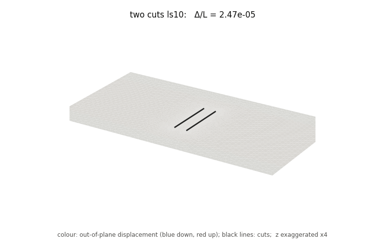 | 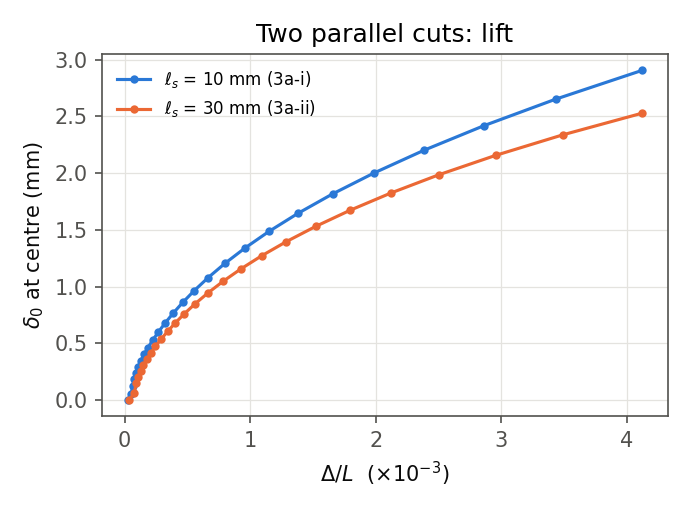 |

- **Geometry.** Sheet 182 × 100 mm, two cuts of b = 40 mm. The paper does not give its
  Fig. 3 dimensions.
- **Lift.** The strip between the cuts lifts as a single bump. At Δ/L = 3.4×10⁻³ the
  centre lifts by δ₀ = 2.65 mm for ℓ_s = 10 mm and 2.34 mm for ℓ_s = 30 mm. The paper reports
  ≈ 3.4 mm and ≈ 3.0 mm at a similar strain.
- **Trend.** Lift drops as the spacing grows, as in Fig. 3b.

### Pitch actuator: convex vs concave unit cell (Fig. 4a/b)

| Concave, (2L_c + L_∥)/w = 1.16 | Convex, (2L_c + L_∥)/w = 0.80 |
|:---:|:---:|
| 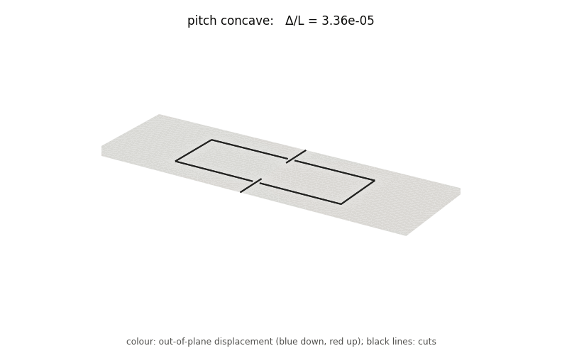 | 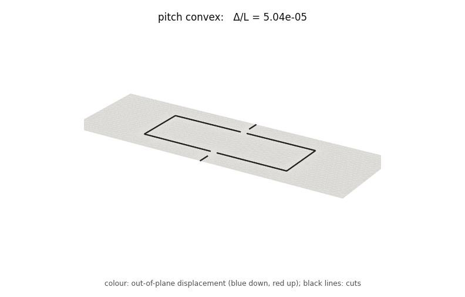 |

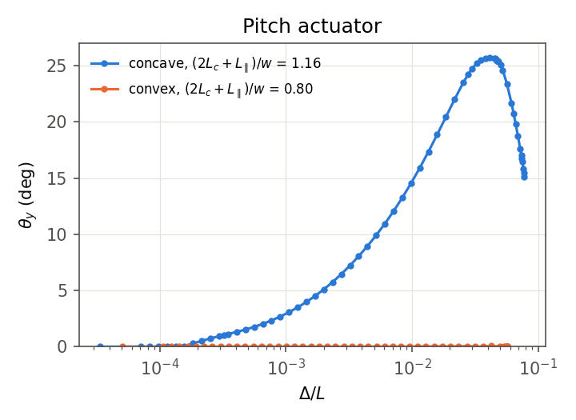

**Geometry.** Proportions follow the paper's MoS₂ actuator, scaled to w = 60 mm:
- Sheet: L = 180 mm.
- Inner ribbon: 95 × 32 mm, held by two 4 mm ligaments at mid-length.
- Edge cracks: length L_c, running through the ligament gaps.

**Results.** They show the paper's central claim: the shape of the polygon formed by the
crack tips decides lift versus rotation.
- *Concave cell.* The ribbon see-saws about the y-axis. θ_y peaks at 25.7° at Δ/L = 0.04,
  then unwinds to 15° at Δ/L = 0.078. Fig. 4b reports 10–20° over Δ/L = 0.03–0.05.
- *Convex cell.* θ_y stays at 0° (maximum 0.07°). The sheet only lifts, by 6 mm. Its run
  stopped at Δ/L = 0.057 because Newton stopped converging.

### Roll actuator (Fig. 4c right, Fig. 5)

| Roll | Mesh (traced from the paper's schematic) |
|:---:|:---:|
| 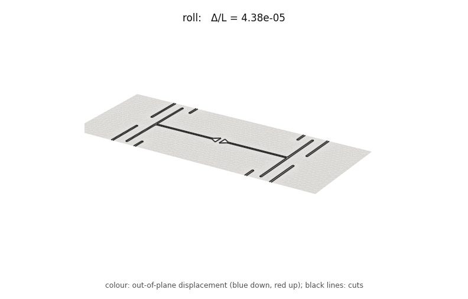 | 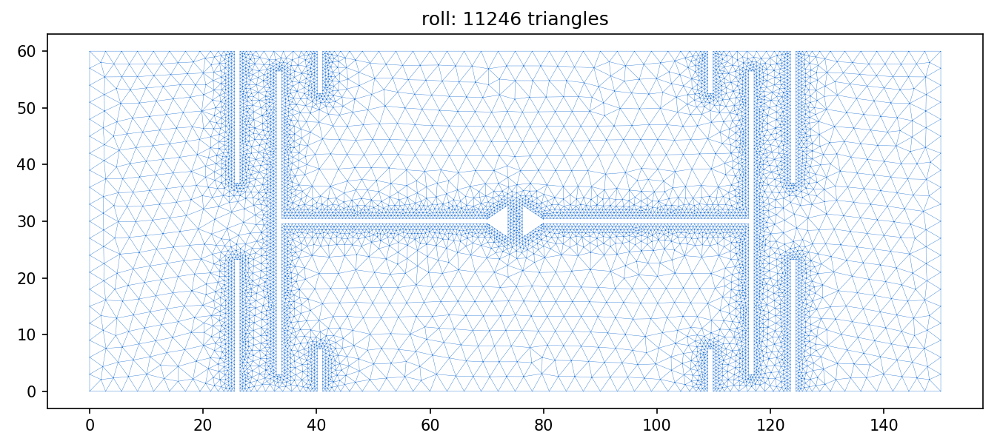 |

**Geometry.** The cut pattern is traced from the schematic in Fig. 4c and scaled to
150 × 60 mm. Its slits meet in T-junctions, so they are modelled as 1 mm slots:
- edge cracks with a central gap;
- a long internal slit;
- short edge notches;
- a horizontal slit that joins the long slit in a T and ends in arrow-shaped tips, leaving
  a 2.5 mm neck at the centre.

**Results.**
- The central panel folds up along its horizontal slit. Each half rolls about x by up to
  54° at Δ/L = 0.15; the paper reports θ_x ≈ 55–60° in the same range.
- The two halves turn in opposite directions, in the symmetric "roof" mode that comes from
  the first buckling mode. The paper's figure does not make clear whether its halves turn
  the same way.

### Yaw actuator (Fig. 4c left, Fig. 1b, Fig. 5)

| Yaw, with frame strips (`yaw`) | Mesh |
|:---:|:---:|
| 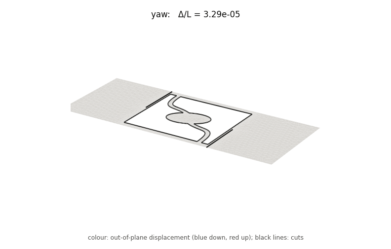 | 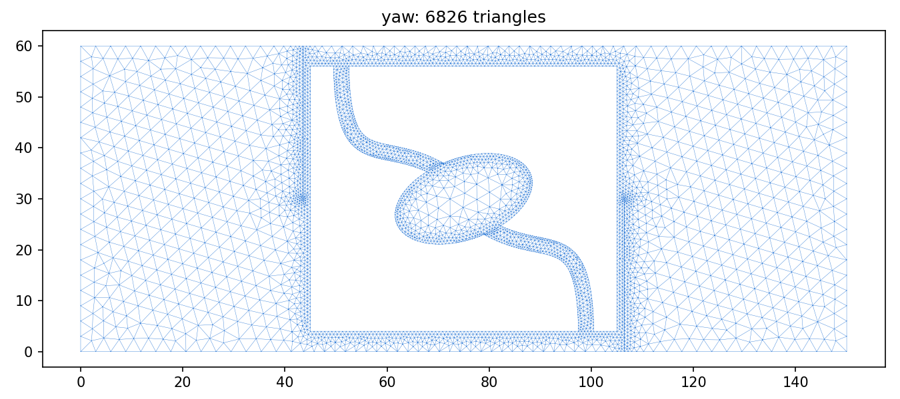 |

**Geometry.** Simplified from the Fig. 4c schematic, 150 × 60 mm:
- a window leaves two 4 mm frame strips joining the clamped pads;
- an elliptical leaf (28 × 16 mm) hangs from two 3 mm S-shaped arms, anchored on the top
  strip near the left end and on the bottom strip near the right end;
- edge cracks beside the window leave each strip attached through a narrow column.

The paper's comb slits are omitted.

**Results.** Stretching pulls the two anchors apart, which loads the leaf by a couple.
- *The leaf.* It stays flat in its own plane: its long axis has 0° out-of-plane tilt, though
  the arms lift the whole leaf by about 20 mm. Its in-plane rotation θ_z is small up to
  Δ/L ≈ 0.07. It then rises steeply, snapping from −9.5° to −18° in one load step, and
  reaches 20.6° at Δ/L = 0.1.
- *The frame strips* kink near the anchors, as in the paper's FEM image.
- *Comparison with the paper.* Yaw is the stiffest mode there too: θ_z stays near 0 until
  Δ/L ≈ 0.1 and reaches about 25° only at Δ/L ≈ 0.3–0.4. The onset here comes earlier.

**Why the strips matter.** A first version without frame strips (`yaw_nostrips`,
[GIF](results/configs/yaw_nostrips.gif)) joined the pads only through the arms. Its leaf
tumbled out of plane, with its long axis tilting 69° from the sheet. That is not yaw.

### Summary (cf. Fig. 5a)

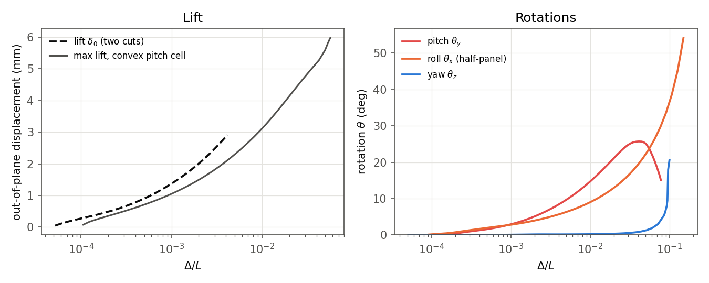

### Rotating squares: loading modes and thickness

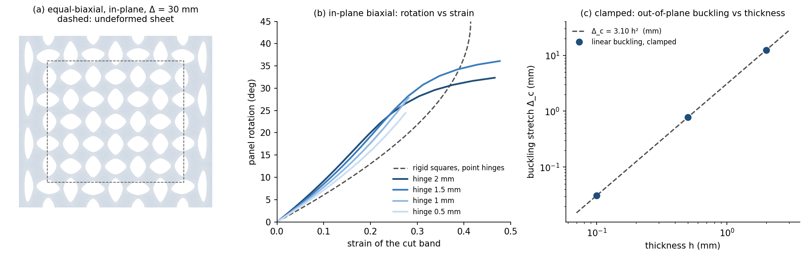

The roller, biaxial and in-plane modes are checked on rotating-squares kirigami (generator
`rotating_squares`), the level-1 pattern of Cho *et al.*, *PNAS* **111**, 17390 (2014).

**Geometry and material.**
- A band of 8 × 8 square panels, a = 8 mm, joined at their corners by hinges about t/2 wide.
  As a string: `P8x16S1/2O0[H12@0,0;V12@0,1/2]N9E4` for t = 4. Narrower hinges lengthen the
  slits to 2a − t and set `E` to t; the general rule is in
  [`KIRISMILES.md`](KIRISMILES.md#the-papers-configurations).
- Material: E = 2 MPa, ν = 0.49, a soft, nearly incompressible rubber.
- Sheets: 120 × 64 mm for the clamped runs, 72 × 64 mm for the roller and biaxial runs.
- Strains below are those of the cut band, measured from the panel centres. The solid end pads
  barely stretch, so the band strain is about 1.6 × Δ/L in the clamped runs.
- Panel rotations are least-squares fits to the core of each inner panel.

**Thickness, clamped (panel c).** The linear buckling stretch follows Δ_c = 3.10 h² mm for
h = 0.1, 0.5 and 2 mm. This h² scaling is exact in a linear plate buckling analysis, so it is
not a test; the content is the competition with the in-plane mechanism. Tilt and rotation
below are 3D rigid fits of the inner panels (`rotation_and_tilt` in
`scripts/plot_rotating_squares.py`).
- *h = 2 mm.* The panels rotate in plane with tilt below 0.3° up to a band strain of 0.27
  (19°), although Δ_c = 12.4 mm corresponds to a band strain of 0.18: past it, the small tilt
  seeded by the buckling mode decays. They then tilt as well, by 6° at a band strain of 0.30,
  where the run stops (Newton fails at Δ = 22.8 mm), with a rotation of 21°.
- *h = 0.5 mm.* The panels tilt from the start (12° tilt, 3° rotation at a band strain of 0.05);
  the tilt saturates near 24° while the rotation keeps growing (15° at 0.2, 24° at 0.37).
- *h = 0.1 mm.* 14° tilt at a band strain of 0.04, where the run stops (Newton fails at
  Δ = 2.5 mm).

The thickness at which in-plane rotation wins is comparable to the hinge width w_h: in-plane
hinge bending scales as E h w_h³ (Cho et al.), out-of-plane as E h³ w_h, a ratio of (w_h/h)².

**Equal-biaxial, in plane (panels a, b).**
- The loading is symmetric, as it should be: the band strains equally along x and y at every step
  (0.466 and 0.469 at the end).
- Neighbouring panels counter-rotate in a checkerboard (every panel of one sublattice turns
  one way). The rotation of the inner panels has a spread of 0.3° at the end.
- The relation between rotation and strain is the same under clamped and biaxial loading: about
  0.14 mean strain at 13.5°.
- With finite hinges the band strains less than rigid squares with point hinges would at the
  same rotation, about 70% as much at 15°.
- The stiffness rises smoothly as the rotation reaches about 30°; there is no sharp lock-up.

**Hinge width (panel b).**

| hinge (≈ t/2) | t (mm) | element size at the cuts (mm) | initial stiffness (N/mm) | band strain where stiffness is 3× initial |
|---|---|---|---|---|
| 2 mm | 4 | 0.5 | 0.34 | 0.18 |
| 1.5 mm | 3 | 0.375 | 0.24 | 0.20 |
| 1 mm | 2 | 0.25 | 0.17 | 0.26 |
| 0.5 mm | 1 | 0.125 | 0.12 | not reached (Newton stalls at 0.28, 24.5°) |

Narrower hinges make the sheet softer, delay the stiffening and move the rotation–strain curve
toward the rigid mechanism. The rigid mechanism reaches its maximum equal-biaxial strain of
√2 − 1 ≈ 41% at 45°; Cho *et al.* (Fig. 1 caption) give a maximum lateral strain of 43% for
the level-1 structure, in plane-strain finite elements with the same panel size, hinge width and
rubber. Our 2 mm hinges reach a band strain of 0.466 at 32°, beyond the rigid value of 0.38,
so the panels and hinges stretch.

**Mesh.** Halving the element size at the cuts (hinge 2 mm, 0.5 → 0.25 mm) changes the force,
the rotations and the band strain by less than 1% at every step. The peak local strain is not
mesh-converged: it sits at the slit tips. It is reported, but not used as a criterion.

**Roller, in plane.** The run stops at a band strain of 0.30, where Newton stalls. The 4 mm
solid strips at the loaded ends presumably resist sideways stretching: the band expands
sideways by only 0.09 (0.30 along the pull). To model uniaxial stress on the band itself, put the loaded edges at the band.

### Kirigami shell: pop-ups in a rolled triangular pattern

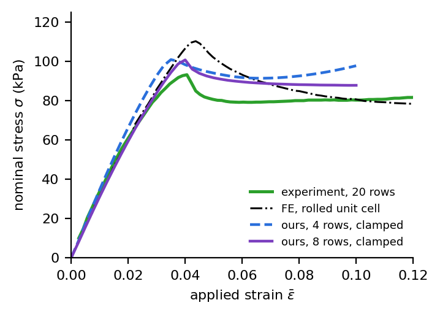

Benchmark against Rafsanjani, Jin, Deng and Bertoldi, *PNAS* **116**, 8200 (2019),
doi:10.1073/pnas.1817763116. The experiment and their rolled-unit-cell FE curves are
digitised by hand from their SI Fig. S17A (`results/tube/rafsanjani_s17a_digitised.json`,
approximate, for comparison only).

**Geometry and material (theirs).** A PET sheet, t = 76.2 µm, E = 4.33 GPa, ν = 0.4, with a
triangular pattern of l = 12 mm and hinges δ = 0.75 mm, laser-cut 0.1 mm wide. It is rolled
into a cylinder of n = 8 unit cells (L = 20.8 mm) around and 20 rows (H = 12 mm) along it, with
the overlapping edges glued and the ends glued to caps.

**Our model** (`kirigami/tube.py`, driver `scripts/tube_triangular.py`).
- Kirchhoff–Love shell on the closed cylinder, R = nL/2π = 26.5 mm, cuts as 0.1 mm slots.
- Rolling: the natural curvature is lowered from that of the cylinder to zero, so the shell
  carries the bending prestress of a rolled sheet.
- Ends as their 20 × 1 super-cell: bottom ring fixed; top ring moved by Δ along the axis,
  free radially and around; neither ring may rotate.
- 4 and 8 rows instead of 20, with a 1.5 mm uncut margin at each end. The mesh is refined at
  the cut tips (h_tip/h_cut/h_far = 0.3/0.7/2.0 mm); the finer mesh (0.2/0.5/1.5) changes
  the stress by less than 2% on 4 rows.

**Strain and stress.** ε̄ = Δ/L₀, with Δ from the rolled state and L₀ the rolled length
between the rings; σ = F/(nLt), F the axial reaction. These are the definitions of their FE.
The experiment measures ε̄ between markers on rows 3 and 18 of 20 instead.
`scripts/tube_marker_strain.py` applies the marker definition to our runs.

| | E = σ/ε̄ (MPa) | peak σ (kPa) at ε̄ | σ after the peak (kPa) |
|---|---|---|---|
| experiment, 20 rows | 3.49 | ~93 at ~0.040 | ~80 |
| their FE, rolled unit cell | 3.17 | ~110 at ~0.044 | ~80 at 0.10 |
| ours, 4 rows clamped | 3.47 | 101 at 0.035 | 92, rising to 98 at 0.10 |
| ours, 8 rows clamped | 3.11 | 101 at 0.040 | 88 |

- The trend is reproduced: a linear rise, a peak, a drop as the cuts pop up, and a plateau.
- In the 8-row shell the pop-ups start next to the top end (the end the triangles point to)
  at ε̄ ≈ 0.045, and spread down. They reach the third row from the bottom at ε̄ = 0.10, the
  order seen in their experiments.
- The popped region is a band of whole rows. Within a popped row the radial displacement is the
  same, to within 2%, in every 45° sector, so the pop-ups vary along the axis only. The band grows
  rather than popping all at once because a row softens as it pops, which is the stress drop
  after the peak. Further stretching goes mostly into the popped rows, and the front moves one
  row at a time, as in other propagating instabilities.
- Going from 4 to 8 rows moves the peak to the experimental strain and removes the late rise.
  The end rows stay nearly round, at 0.2–0.6 mm radial displacement against 1.4–1.7 mm in the
  popped rows. With markers, the interior strain of the 8-row shell is ~12% larger than ε̄
  before the peak, so E = 2.67 MPa.
- A shell periodic along its axis (`--periodic`, 4 rows, radial imperfection 0.5 t) passes the
  peak at 102 kPa (ε̄ = 0.045). Its full ring then ovalises, a mode their rotation-periodic
  sector excludes, so it is not shown.
- Cost: 52 min for 8 rows (4 × 10⁵ unknowns, ~2 GB) on a laptop in Docker.

Figure: `python scripts/plot_tube_paper.py`.

## Caveats

- **Dimensions.** The paper only fully specifies the single-cut geometry. Every other
  pattern here is traced or scaled from its schematics, so compare trends and orders of
  magnitude, not exact curves.
- **Imperfection.** Results depend on which buckling mode seeds the post-buckling path.
  The first mode is used throughout. Symmetric and antisymmetric variants of a mode are
  equally valid, and the GIFs show the dominant deflection pointing up.
- **Material.** A linear (St Venant–Kirchhoff) material is used up to Δ/L ≈ 0.1–0.15.
  PET would yield locally at the crack tips well before this, but the paper's FEM also
  appears to be elastic. In the rotating-squares runs, the peak hinge strain on these meshes passes
  1 at band strains of about 0.15–0.2. Beyond that, the curves show the trend, not a material-accurate response.
- **Load control.** Δ is imposed and Newton steps are bisected when they fail. Near steep
  stiffening or snapping, the step can shrink until the run stops. This happened in the thin
  (h = 0.1 mm) clamped and roller runs, the in-plane roller run, and the 1 mm-hinge biaxial run at
  a band strain of 0.28.
