# 切り😊 KiriSMILES

**Kiri**gami **S**implified **M**etamaterial-**I**nput **L**ine-**E**ntry **S**ystem: one line
of text for one kirigami cut pattern.

*Kiri* (切り) is Japanese for "cut". The name borrows from SMILES, the line notation chemistry uses
for molecules (Weininger, *J. Chem. Inf. Comput. Sci.* 28, 31, 1988). Ethanol is `CCO`; the classic
alternating kirigami is `P5x45S1/2O0[V42@0,0]N18E3`.

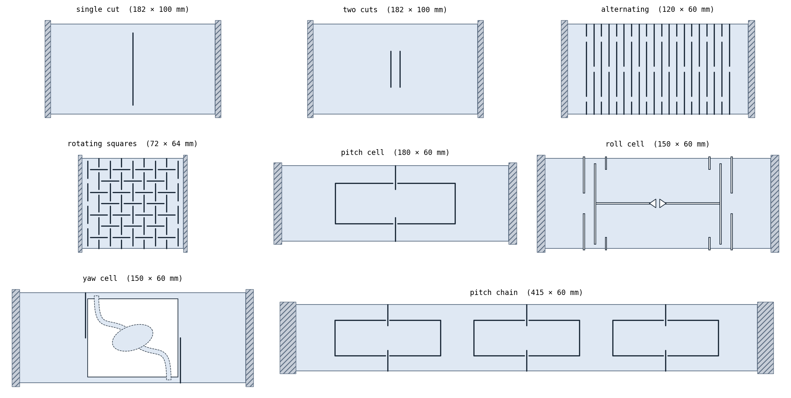

*Every configuration of* Kirigami Actuators *(Dias* et al.*, Soft Matter 2017), drawn from its
string. The strings are listed [below](#the-papers-configurations).*

Every figure on this page is drawn by the parser from the string printed above each panel, so a
figure always shows what its string really cuts. To redraw them, run
`python scripts/plot_kirismiles.py`.

**Contents**

1. [A quick tour](#a-quick-tour)
2. [Why a line notation](#why-a-line-notation)
3. [The sheet and its coordinates](#the-sheet-and-its-coordinates)
4. [Free form: the building blocks](#free-form-the-building-blocks)
5. [Operations: groups, mirrors, inversion, repetition](#operations-groups-mirrors-inversion-repetition)
6. [Worked example: the pitch cell](#worked-example-the-pitch-cell)
7. [Lattice form](#lattice-form)
8. [The paper's configurations](#the-papers-configurations)
9. [Grammar](#grammar)
10. [Identity: canonical string and geometry key](#identity-canonical-string-and-geometry-key)
11. [Validity](#validity)
12. [Use](#use)
13. [Limitations](#limitations)

## A quick tour

| String | Reads as |
|---|---|
| `V80@0,0` | one 80 mm slit across the pull, at the centre of the sheet (the paper uses 182 × 100 mm) |
| `(V40@6,0){mx}` | a 40 mm slit at x = 6, plus its mirror image at x = −6 |
| `(C(8,4;24,4;24,14)){mx}{my}` | an L-shaped cut, mirrored left–right and then top–bottom: four cuts |
| `(V20@0,0){t10x5}` | five 20 mm slits, 10 mm apart, centred |
| `R30:24@0,0` | a 24 mm slit at 30° to the pull |
| `K15@25;K15@-25t` | a crack 15 mm up from the bottom edge, and one 15 mm down from the top |
| `C(-20,-8;-20,8;20,8;20,-8)k1.5` | a U-shaped cut, cut as a 1.5 mm wide slot |
| `P5x45S1/2O0[V42@0,0]N18E3` | a 42 mm slit repeated on a staggered 5 × 45 mm lattice, 18 columns |

A string has one of two forms:

- the **free form** places pieces (slits, cuts, cracks, holes, solids) directly in the sheet and
  can copy them with symmetry operations;
- the **lattice form**, which starts with `P`, repeats a motif on a lattice.

## Why a line notation

KiriSMILES is the first standard of an open-source effort to lay down the infrastructure for
kirigami informatics (see the [README](README.md#what-is-the-kirismiles-project)). This section
explains why it is needed: what existing descriptions cannot do, which ideas carry over from
chemistry, and what the notation is for.

### What is missing

SMILES works because a molecule is a graph of atoms and bonds, and a string can walk that graph.
A kirigami sheet has no such agreed description. Designs are shared in four ways, and each
answers a different question:

- **A figure** shows what the pattern looks like, but not its exact dimensions.
- **Family parameters**, such as slit length b, gap g and spacing d for the alternating pattern,
  place a design within one family but mean nothing outside it.
- **A cut file** (SVG, DXF) says exactly what to cut, but as hundreds of unrelated coordinates.
  Nothing in it says the pattern is one slit repeated on a lattice, and two files can describe
  the same pattern without anyone noticing.
- **A generator function** in code reproduces a family, but only for whoever has that code.

This repository shows the problem on a small scale. Before KiriSMILES, the eight configurations
of *Kirigami Actuators* needed eight generator functions with their own parameters: `b, g, d,
n_rows` for the alternating pattern, `a, t, nx` for rotating squares, `Lc, Lpar, Lr, gap` for the
pitch cell. The same letter changes meaning between them: `b` is a slit length in three of them
and an ellipse's semi-axis in the yaw cell. And only the single cut is fully dimensioned in the
paper; every other geometry here had to be traced from its schematic.

None of these descriptions is at once short, exact, readable by people, parsable by software,
and independent of any one design family. KiriSMILES is meant to be all of these.

### What carries over from chemistry

SMILES does not list atoms with their coordinates. It writes what defines the molecule, its
atoms and their connections, and leaves the drawing to software. KiriSMILES does the same for a
cut sheet: it writes what defines the pattern, not every coordinate.

For kirigami metamaterials, what defines the pattern is usually a unit cell repeated many times,
and much of their behaviour comes from that repetition. A list of the coordinates of 50 slits hides that
`P5x40S1/2O0[V36@0,0]N20E4` is one slit on a staggered lattice. The lattice form writes the unit
and the rule for repeating it, not every copy.

| In chemistry | In KiriSMILES |
|---|---|
| atoms and bonds (SMILES) | pieces: slits, cuts, cracks, holes, solids |
| branches written in parentheses | groups in parentheses, with their symmetry operations |
| conditions such as solvent or temperature, left out of the string | sheet size, thickness and material, left out of the string |
| canonical SMILES and the InChIKey | the canonical string and the geometry key |
| SELFIES: every string is a valid molecule | the aim of a repair map for lattices (not built yet) |

### What it is for

- **A shared language.** Mechanicians, people who design and laser-cut sheets, and researchers
  who build data sets and models can all write and read the same string. A string can be pasted
  into a paper, an issue or a spec file, and it regenerates the cuts exactly.
- **Infrastructure for data-driven design.** The planned results database will store every
  simulated design under its string and its geometry key, so a design that was already computed
  is found instead of solved again. Strings are sequences, so the models used for SMILES and
  SELFIES (language models, string autoencoders) carry over, and descriptors can be computed
  from the string.
- **One design space.** Single slits, lattices and the actuator cells of the paper are points in
  one space, instead of separate generator functions with their own parameters.

### Design principles

1. **Build on SMILES rather than start over.** Short letters for pieces, parentheses for groups,
   and context kept out of the string, as in chemistry.
2. **Groups behave like pieces.** A group with its symmetry operations can stand wherever a
   single piece can, so larger patterns are built by nesting smaller ones.
3. **Geometry only.** The string says what is cut, not how the sheet behaves or what it is made
   of. Properties are results, stored next to the string.
4. **Exact meaning, validity checked separately.** Every string that parses describes one
   definite pattern. Whether that pattern can be cut and clamped is a separate check, as a
   SMILES string can be well formed yet describe a molecule that cannot exist.
5. **Written the way designers think.** Symmetry operations and edge-relative coordinates
   (`b`, `t`) let a string say "this cut, mirrored" or "3 mm below the top edge", not only
   where each cut ends up.
6. **One identity for one design.** However a design is written, its geometry key is the same,
   so equal designs can be found and counted.

## The sheet and its coordinates

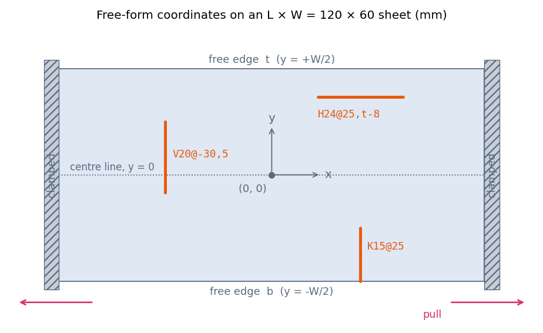

- The sheet is L × W and is pulled along x. By default the ends x = 0 and x = L are clamped, and
  the edges y = 0 and y = W are free. Like the material, the loading is context, not part of the
  string: a spec can choose roller ends or equal-biaxial loading instead
  ([details](BENCHMARK.md#models)).
- Lengths in a string carry no unit: the unit is context, like the sheet size and material, so the
  same string can describe a centimetre-scale sheet or a micrometre-scale one. This repository, its
  tools and all the examples here use **mm**.
- In the free form, **x is measured from the middle of the sheet** and **y from the centre line**.
  A point at `0,0` is the centre of the sheet.
- y can also be measured **from a free edge**: `b+2.9` is 2.9 mm above the bottom edge, `t-3.5`
  is 3.5 mm below the top edge, and `b` and `t` are the edges themselves. A feature written this
  way stays on its edge when W changes.
- Sheet size, thickness and material are *context*. They are not part of the string, just as
  SMILES leaves out conditions. The same string can be cut into sheets of different sizes.
- Spaces are ignored, so a long string can be broken up for reading.

## Free form: the building blocks

Pieces are joined by `;`. There are three kinds of piece:

- **cuts** have zero width: slits, polyline cuts and cracks;
- **holes** remove material;
- **solids** add material back after all holes are cut.

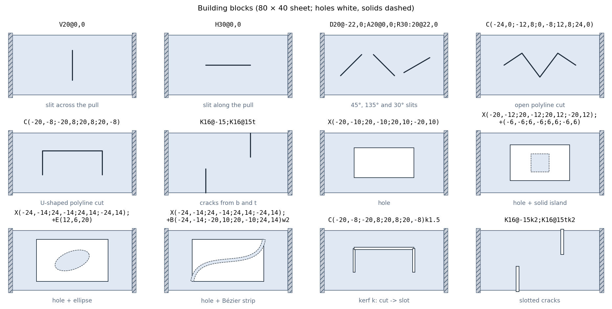

| Piece | Meaning |
|---|---|
| `V80@x,y` | straight slit of length 80 centred at (x, y), across the pull (along y) |
| `H80@x,y` | the same along the pull (along x) |
| `D80@x,y`, `A80@x,y` | the same at 45° and at 135° |
| `R<deg>:<len>@x,y` | the same at any whole angle in degrees: `R30:24@0,0` is a 24 mm slit at 30°. The `:` ends the angle |
| `C(x,y;x,y;…)` | cut along a polyline through the points |
| `K<len>@x` | crack running len mm in from the bottom edge (`K<len>@xb` says the same) |
| `K<len>@xt` | crack running len mm in from the top edge |
| `X(x,y;…)` | hole: the polygon is removed |
| `+(x,y;…)` | solid: the polygon is added back after the holes |
| `+E(a,b,deg)` or `+E(a,b,deg)@x,y` | ellipse added back, with semi-axes a and b, rotated by deg, at the centre or at (x, y) |
| `+B(p0;p1;p2;p3)w<w>` | strip of width w along the cubic Bézier curve with control points p0…p3, added back |
| `k<w>` after a slit, cut, crack or group | **kerf**: the cuts become slots of width w (holes) |

**Cuts or slots.** A plain cut has no width, which is how the paper's simulations treat a thin
slit. Adding `k<w>` turns each straight piece into a slot of width w with square ends, which is
what a laser actually removes. Slots may meet and cross, but zero-width cuts may not (see
[Validity](#validity)). A slot that starts at an edge starts 1 mm outside it, so it opens the
edge cleanly. A kerf after a group applies to every cut inside that does not have its own kerf.

**Islands.** A solid inside a hole is an island of material. It is only connected to the sheet
if something joins it, such as the Bézier strips of the yaw cell. Otherwise `check` reports a
loose piece.

## Operations: groups, mirrors, inversion, repetition

Parentheses make a **group**, and a group may end with any number of operations, applied left to
right. Each mirror or inversion doubles the pieces in the group, keeping the originals and adding
their images. All operations act about the centre of the sheet, the origin of the free-form
coordinates.

| Operation | Effect on each point | Copies |
|---|---|---|
| `{mx}` | mirror left–right: x → −x | ×2 |
| `{my}` | mirror top–bottom: y → −y (a crack from `b` becomes one from `t`) | ×2 |
| `{i}` | inversion through the centre: (x, y) → (−x, −y), a half turn | ×2 |
| `{t<p>x<n>}` | n copies, p mm apart along x, centred on the original | ×n |

In the figure below, orange is what was written and blue is what the operation added. The dotted
lines are the sheet's mirror axes.

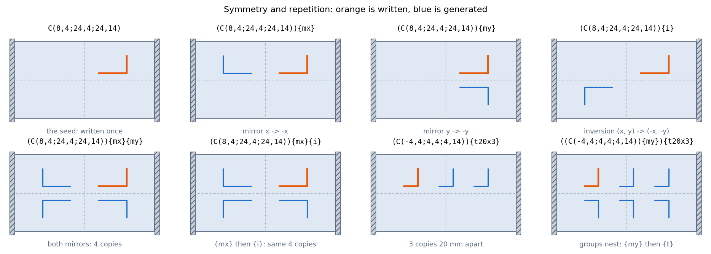

Things to notice:

- **The seed has no symmetry of its own.** An L-shaped cut makes it easy to tell the mirror
  images (`{mx}`, `{my}`) from the half turn (`{i}`): a mirror image is reversed, while the
  inversion only turns it around.
- **Operations compose.** `{mx}{my}` gives four copies. `{mx}{i}` gives the same four, since a
  mirror in x followed by a half turn is a mirror in y. Both strings have the same
  [geometry key](#identity-canonical-string-and-geometry-key).
- **Repetition is centred.** `{t20x3}` puts copies at −20, 0 and +20 mm from where the piece
  was written. To repeat a piece written at x = 0, the original is the middle copy. In the
  figure the seed was written at x = 0 and the orange copy is the leftmost one, at −20 mm.
- **Groups nest.** `((…){my}){t20x3}` first mirrors the piece and then repeats the pair. The
  inner group's operations are applied before the outer group's.
- **Symmetries keep strings short and closer to unique.** The pitch cell is one U-shaped cut
  and one crack, each mirrored. The roll cell is half a cell with `{mx}`. The yaw cell is half
  the S-shaped strips with `{i}`.

## Worked example: the pitch cell

The pitch actuator of the paper is a ring of cuts with two cracks:

```
(C(2,16;47.5,16;47.5,-16;2,-16)){mx};(K18.75@0){my}
```

It is built in four steps. Orange is the piece written in that step.

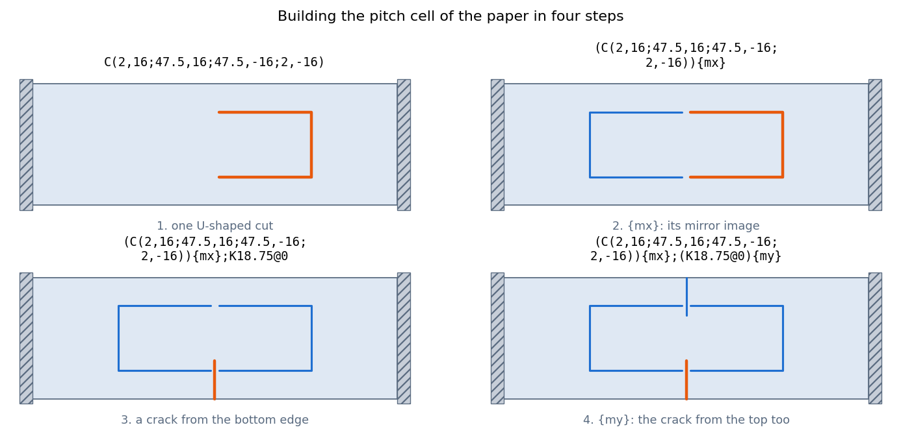

1. `C(2,16;47.5,16;47.5,-16;2,-16)` is a U-shaped cut opening to the left. It starts 2 mm right
   of the centre, so the left and right halves will be 4 mm apart.
2. `(…){mx}` adds its mirror image. The 4 mm gaps at the top and bottom are the ligaments that
   hold the cell together.
3. `K18.75@0` adds a crack 18.75 mm up from the bottom edge, at x = 0, running through the lower
   gap.
4. `(K18.75@0){my}` mirrors the crack, so it also runs down from the top edge.

Three of these cells in a row make the pitch chain: `((…)){t125x3}` on a 415 mm sheet, or the
lattice string in the [table](#the-papers-configurations).

## Lattice form

A motif repeated on an oblique lattice inside a band of the sheet:

```
P5x45S1/2O0[V42@0,0]N18E3
│     │   │  │        │  └ E: edge trim, drop clipped pieces shorter than 3 mm
│     │   │  │        └ N: 18 lattice columns, centred in the sheet
│     │   │  └ motif: one slit, V(ertical, across the pull), 42 mm, at the lattice point
│     │   └ O: y offset of the lattice (mm)
│     └ S: each column shifted by 1/2 cell along y
└ P: cell 5 mm (along the pull) × 45 mm (across)
```

| Part | Meaning |
|---|---|
| `P<px>x<py>` | lattice cell: px along the pull, py across it |
| `S<s>` | column shift: column i is shifted by i·s·py along y, so `0` keeps the columns in register and `1/2` staggers them |
| `O<o>` | y offset of column 0's lattice point from the centre line |
| `[motif]` | pieces joined by `;` (see below) |
| `N<n>` | number of columns. The band they fill spans (n − 1)·px and is centred in the sheet |
| `E<e>` | trim: every cut piece shorter than e is dropped. In practice these are the stubs the free edges leave, but a motif piece shorter than e (a notch, say) is dropped too, so keep e below the shortest intended cut |

The lattice points are at x = x₀ + i·px and y = W/2 + o + (i·s + j)·py, for columns
i = 0 … n − 1 and every row j that reaches the sheet. Rows have no count: **the lattice fills the
sheet across its width**, and only the number of columns is given.

In the figures below the orange dots are the lattice points, the dashed parallelogram is one cell
(px across, shifted up by s·py), and the shaded strip is the band.

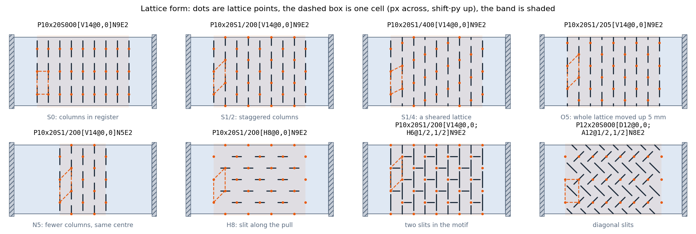

**Slits in a motif** are written `<dir><length>@<u>,<v>`. The direction letters are those of the
free form, but the position u, v is a **fraction of the cell**, of px and py, written as a
fraction such as `1/2`. `V14@0,0;H6@1/2,1/2` puts a vertical slit at each lattice point and a
horizontal one at the centre of each cell. A slit is kept only if it lies within the band.

**The free edges.** Where a slit crosses a free edge it is clipped, and the piece left inside the
sheet becomes an edge crack. These are the short cuts along the top and bottom of the alternating
pattern. `E` sets how short such a piece may be before it is dropped:

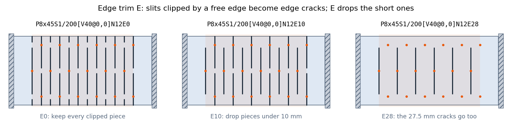

With a 45 mm cell and 40 mm slits on a 60 mm wide sheet, the clipped pieces are 5 mm and
27.5 mm long. `E0` keeps all of them, `E10` drops the 5 mm stubs, and `E28` also drops the
27.5 mm cracks, leaving only the uncut 40 mm slits.

**Other pieces in a motif.** A motif may also hold any free-form piece except cracks, with
coordinates **in mm from the lattice point**. Groups, symmetries and kerfs work as in the free
form. Each piece is copied once to every lattice point of columns 0 … n − 1. Cuts are clipped at
the free edges like slits, and solids are clipped to the sheet. Cracks and edge coordinates
(`b`, `t`) are not allowed in a motif, because a lattice point does not know where the edges are.

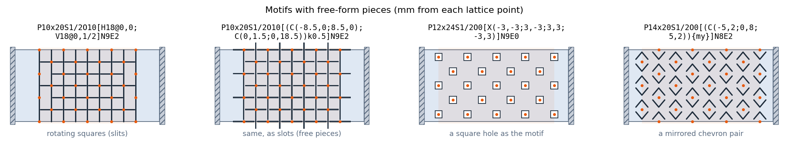

The second panel is the rotating-squares pattern of the first, cut as 0.5 mm slots with 1.25 mm
hinges:

```
P10x20S1/2O10[(C(-8.5,0;8.5,0);C(0,1.5;0,18.5))k0.5]N9E2
```

## The paper's configurations

| Design | KiriSMILES | Sheet (mm) |
|---|---|---|
| single cut | `V80@0,0` | 182 × 100 |
| two cuts | `(V40@5,0){mx}` | 182 × 100 |
| alternating | `P5x40S1/2O0[V36@0,0]N20E4` | 120 × 60 |
| rotating squares | `P8x16S1/2O0[H12@0,0;V12@0,1/2]N9E4` | 72 × 64 |
| pitch cell | `(C(2,16;47.5,16;47.5,-16;2,-16)){mx};(K18.75@0){my}` | 180 × 60 |
| pitch chain | `P125x200S0O0[(C(0,-30;0,-11.25)){my};(C(2,16;47.5,16;47.5,-16;2,-16)){mx}]N3E0` | 415 × 60 |
| roll cell | `((K23.25@49){my};(K7.5@34.4){my};C(41.6,0;5,0);C(41.6,b+2.9;41.6,t-3.5);X(1.25,-2.9;5.5,0;1.25,2.9)){mx}k1` | 150 × 60 |
| yaw cell | `(+B(-24,t-2;-24,2;-16,14;-2,4)w3;K30@-31.5t){i};+E(14,8,20);X(-30,b+4;30,b+4;30,t-4;-30,t-4)` | 150 × 60 |

**Rotating squares in general.** Square panels of side a with hinges about t/2 wide, nx panels
along the pull, on a sheet of width W, are

```
P<a>x<2a>S1/2O<o>[H<2a−t>@0,0;V<2a−t>@0,1/2]N<nx+1>E<t>      o = (−W/2) mod 2a
```

Horizontal slits sit on one checkerboard of lattice vertices and vertical slits on the other.
Horizontal slits on the first and last columns would reach outside the band, so they are not
kept, which leaves the solid pads intact. For example, the panels of the rotating-squares
validation in [`BENCHMARK.md`](BENCHMARK.md) (a = 8, t = 4, nx = 8, W = 64) are
`P8x16S1/2O0[H12@0,0;V12@0,1/2]N9E4`, and its narrower hinges change only the slit length and
the trim: `H13`/`V13` and `E3` for t = 3, `H14`/`V14` and `E2` for t = 2.

The figure at the top of this page draws these strings. `tests/test_kirismiles.py` checks
that each one cuts exactly what the original generator in `kirigami/geometry.py` cuts (same
geometry key).

**Beyond the paper.** `specs/corpus/literature.json` writes 20 kirigami designs from the
literature as strings, from 7 to 674 characters:
- the actuator cells of *Kirigami Actuators*, including the lift cell with relief cuts, whose
  coordinates come from the original vector design file;
- parallel slits and rotating squares, plus the level-2 hierarchical cuts of Cho *et al.*, whose
  hinges were checked by counting rigid-unit modes (`scripts/verify/`);
- rotating triangles;
- the triangular and circular-arc cuts of kirigami skins, and the triangular cuts of a pop-up
  shell (unrolled), built from the geometry given in their supplementary material;
- a grid of rectangular cuts used for machine-learning design;
- one instance each of a graded and a random-link rotating-squares pattern, written piece by
  piece;
- the planar precursors of 3D assemblies.

Dimensions follow each paper where it gives them and are close to its figures otherwise. The
strings aim at the same cut topology and similar behaviour, not exact replicas. A circular arc is
written as a polyline. Designs with a non-rectangular outline, such as disks, cannot be written
yet, because the sheet is always an L × W rectangle. Designs whose hinges are narrower than
1 mm set their own `min_gap`.

`python scripts/corpus.py` checks every string, compares the ones that have a generator with it
cut for cut, and draws them all. `python scripts/corpus_tex.py` writes the same strings as a LaTeX
table:

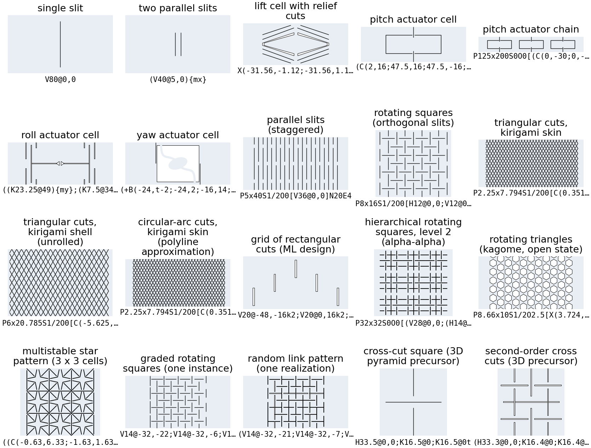

Reading the roll cell, from the inside out: half of the cell is written, and `{mx}` adds the other
half. The half holds two pairs of edge cracks, each pair written once and mirrored with `{my}`; a
cut along the centre line; a long cut across the sheet, measured from the edges so it ends 2.9 mm
above the bottom and 3.5 mm below the top; and a small triangular hole. The final `k1` cuts all of
it as 1 mm slots.

## Grammar

```
string    = lattice | freeform

freeform  = item { ";" item }
item      = group | slit | cut | crack | hole | solid | ellipse | strip
group     = "(" freeform ")" { op } [ kerf ]
op        = "{mx}" | "{my}" | "{i}" | "{t" number "x" integer "}"
slit      = dir number "@" number "," y [ kerf ]
dir       = "H" | "V" | "D" | "A" | "R" integer ":"
cut       = "C" points [ kerf ]
crack     = "K" number "@" number [ "b" | "t" ] [ kerf ]
hole      = "X" points
solid     = "+" points
ellipse   = "+E(" number "," number "," number ")" [ "@" number "," y ]
strip     = "+B" points "w" number                    (exactly four points)
points    = "(" number "," y { ";" number "," y } ")"
y         = number | ( "b" | "t" ) [ ( "+" | "-" ) number ]
kerf      = "k" number

lattice   = "P" number "x" number "S" fraction "O" number
            "[" motifitem { ";" motifitem } "]" "N" integer "E" number
motifitem = dir number "@" fraction "," fraction        (slit, position in cell fractions)
          | item                                     (no cracks, no b/t; mm from the point)
fraction  = integer [ "/" integer ]
number    = [ "+" | "-" ] digits [ "." digits ]       (unsigned inside the lattice header)
```

Spaces are ignored. A string that starts with `P` is read as a lattice.

## Identity: canonical string and geometry key

There are two levels, as in chemistry:

- **Canonical string.** `kirismiles.canonical(s)` normalises the numbers, reduces lattice
  positions and re-anchors the motif. It sorts the pieces of every group and drops duplicates.
  Printing a canonical string again gives the same string.
- **Geometry key.** `kirismiles.geometry_key(s, L, W)` hashes the cut geometry itself. It does
  not depend on how the design was written, the order of pieces or points, or the sheet's two
  mirror symmetries. This key plays the role InChIKey plays for molecules, and it will be the
  database key.

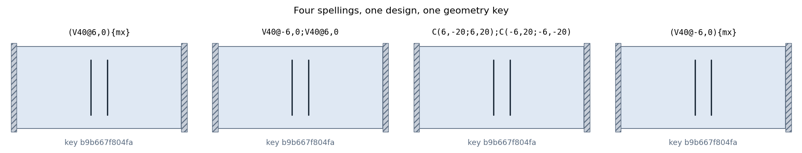

These four strings describe one design. The first and last are mirror images of each other, and the
third writes the two slits as polylines, one of them drawn top to bottom. All four have the key
`b9b667f804fa` on a 120 × 60 sheet.

The key depends on the sheet: the same string on a different L × W cuts a different sheet and has
a different key.

## Validity

Every string that parses describes a definite pattern. Whether the sheet can actually be cut and
clamped is checked separately: `kirismiles.check(s, L, W, min_gap=1.0)` returns readable
problems, and an empty list means the design is valid.

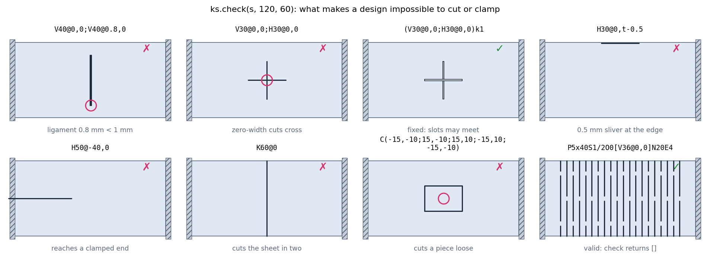

The red circles mark the location given in the message. `check` reports:

- a piece reaching a clamped end, or a cut leaving the sheet;
- zero-width cuts that cross or touch, or a cut running into a hole. Where cuts meet they must be
  slots, so give them a kerf: `(V30@0,0;H30@0,0)k1` is valid;
- a ligament narrower than `min_gap`, between two pieces or between a piece and a free edge it
  does not open onto;
- clamped ends that are no longer joined through material;
- a piece cut loose from both clamped ends.

Connectivity is checked on a pixel grid of 0.1 mm or finer. Messages give the location, for
example
`ligament of 0.80 mm < 1 mm between cuts[0] and cuts[1] near (60.4, 10.0)`.

SELFIES (Krenn *et al.*, *Mach. Learn.: Sci. Technol.* 1, 045024, 2020) makes every string a
valid molecule. For lattices, the same property is the aim of a repair map that shortens or
extends slits until `check` passes. It is not yet part of the notation, and for free-form
curves and solids it remains open.

## Use

```python
from kirigami import kirismiles as ks

code = "P5x40S1/2O0[V36@0,0]N20E4"
d = ks.parse(code)                              # grammar.Design, Lattice or FreeForm
ks.canonical("V40@6,0;V40@-6,0")                # 'V40@-6,0;V40@6,0'
pat = ks.pattern(code, L=120, W=60)             # {"cuts": [...], "holes": [...], "solids": [...]}
ks.geometry_key(code, 120, 60)                  # '7acc55b51e60'
ks.check(code, 120, 60)                         # [] if the design is valid
```

In a JSON spec:
`"pattern": {"generator": "kirismiles", "params": {"code": "..."}}`.

From the command line, `python scripts/kirigami_cli.py validate <spec.json>` runs the same check
(see [TOOLS.md](TOOLS.md)).

## Limitations

Each limit below comes with the reason it exists.

- **Graded and irregular patterns.** A lattice repeats one motif unchanged, so a pattern whose
  slits grow longer along the sheet, or one with no repeat at all, can only be written piece by
  piece. The notation describes local repetition; a rule for variation across
  the sheet would be a new kind of object.
- **Several bands.** A lattice fills one band. Placing different lattices side by side along x is
  not yet written, though it could be added as a sequence of bands.
- **Curved cuts.** Curves exist only as solids (`+B`), not as cuts. A curved cut can be
  approximated by a polyline `C(...)` with many points, which the solver meshes like any other
  cut, but there is no compact way to write one yet.
- **Rectangular sheets.** The sheet is always an L × W rectangle clamped at its short ends, so
  designs cut into a disk or another outline cannot be written yet. Holes can remove material
  inside the rectangle, but the outer boundary is not part of the string.
- **Canonical free form.** Writing the full cell or half of it with `{mx}` still prints two
  different strings. They have the same geometry key, which is what identity rests on.
- **Flat sheets with through-cuts only.** Folds, partial-depth cuts, varying thickness and sheets
  of several materials are outside the notation. Thickness and material are context, and folds
  belong to origami, which would need its own vocabulary.
- **Idealised fabrication.** A kerf is one width for the whole cut. Slots have square ends, and a
  slotted polyline is a union of rectangles with small notches at its corners. A laser's taper
  and rounded ends are not described.
- **Whole-degree angles.** Angled slits take whole degrees (`R30:`); finer angles need a
  polyline cut.
