# 切り😊 KiriSMILES

**An open-source effort to lay down the infrastructure for kirigami informatics.**

> **KiriSMILES** = **Kiri**gami **S**implified **M**etamaterial-**I**nput **L**ine-**E**ntry **S**ystem

*Kiri* (切り) is Japanese for "cut", and the name borrows from SMILES (Simplified Molecular-Input
Line-Entry System), the line notation chemistry uses for molecules. One line of text describes
one cut pattern:

```
P5x45S1/2O0[V42@0,0]N18E3      the classic alternating pattern
```

| Pitch θ_y (concave cell) | Roll θ_x | Yaw θ_z |
|:---:|:---:|:---:|
| 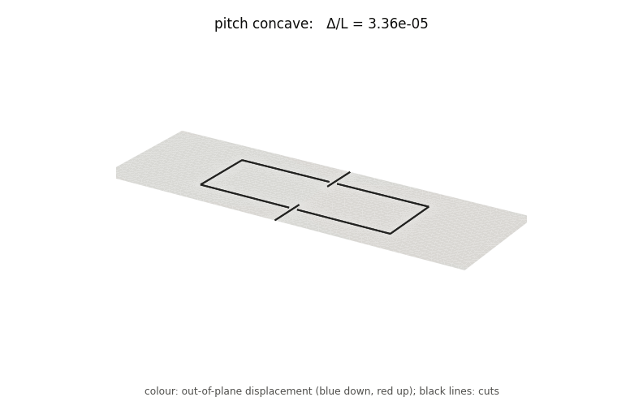 | 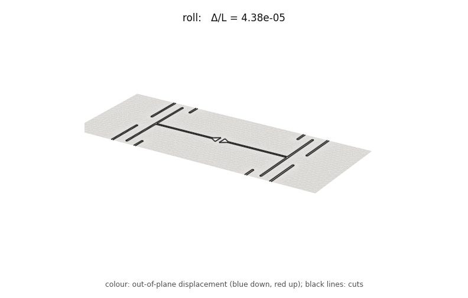 | 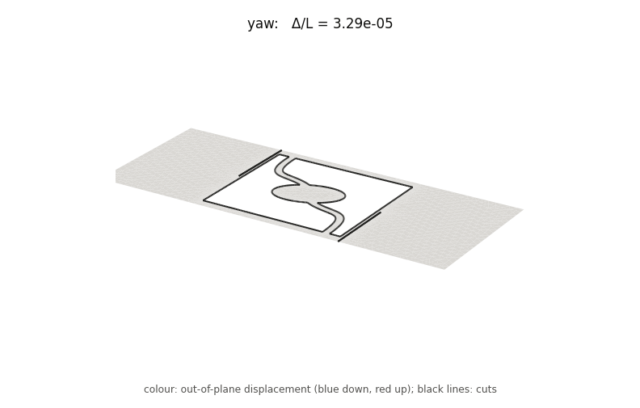 |

## What is the KiriSMILES project?

Kirigami designs are hard to collect and compare. They are shared as figures, as parameters that
only make sense within one family of designs, or as cut files that list hundreds of coordinates,
and the results that go with them are scattered across papers in different forms. Data-driven
kirigami design, from searching a design space to training models, needs designs and results
that are written down the same way by everyone.

The KiriSMILES project aims to lay down the infrastructure for **kirigami informatics**: a series
of standards and open-source software that make it easier for mechanicians, people who design
and fabricate cut sheets, and data and computer scientists to share designs and results, and so
to speed up data-driven kirigami research, in the spirit of Emma Lejeune's
[Mechanical MNIST](https://open.bu.edu/items/c8346371-81b3-42f2-9741-22a6299a119c) datasets.

**Standards**

- **A line notation, KiriSMILES,** that writes a cut pattern, from a single slit to a lattice
  or an actuator cell, as one line of text. [Details](#1-describing-structures-kirismiles).
- **An identity for every design.** A canonical string and a geometry key, so that the same
  design written two ways is recognised as one.
- **A data format.** JSON specs record a design together with its context: sheet, material, mesh
  and load. A results format for an open dataset is on the [roadmap](#roadmap).

**Software**

- **Parsing, checking and generating designs.** The notation's parser and validity checks, and
  generators, symmetry operations and tiling that build patterns from smaller parts.
  [Details](#2-generating-structures).
- **An open-source simulation engine with a benchmark.** A FEniCSx plate and shell solver for
  cut sheets of any material, under clamped uniaxial, roller (uniaxial-stress) or equal-biaxial
  loading, out of plane or kept in plane. It is validated against the finite-element results of
  [*Kirigami Actuators*](https://pubs.rsc.org/sm/article-abstract/13/48/9087/585682/Kirigami-actuators)
  and checked on rotating-squares kirigami. [Details](BENCHMARK.md).
- **A platform for people and AI agents.** The notation and the engine, together with a shared
  job queue and a store of results indexed by the identity of each design, form one platform.
  People use it through a command-line interface, a Python API and a local web app; AI agents
  such as Claude Code use it through an MCP server. Both get the same operations: writing and
  checking designs, running simulations, following their logs, and retrieving results.
  [Details](#4-the-kirismiles-platform).

The project is under active development. The [roadmap](#roadmap) lists what is not built yet, and
[How to get involved](#how-to-get-involved) says how to help.

## Installation

### What you need

| Part | Needed for | How to get it |
|---|---|---|
| Python 3 with numpy, scipy, matplotlib, Pillow | the notation, design checks, command line, web app, plots | `pip install -r requirements.txt` |
| [Docker](https://docs.docker.com/get-docker/) (Docker Desktop on Windows and macOS) | simulations | install Docker, then start it |
| the FEniCSx image `dolfinx/dolfinx:v0.9.0` | simulations | pulled by Docker on the first simulation |
| pytest | the tests (optional) | `pip install pytest` |
| the MCP Python SDK | the server for AI assistants (optional) | `pip install "mcp>=2.3,<3"` |

The solver and everything it depends on, FEniCSx, PETSc, SLEPc, MUMPS and gmsh, live inside the
Docker image, so there is nothing to compile. Writing, checking and drawing designs work without
Docker. The code is developed and tested with Python 3.13 on Windows, with Docker Desktop.

**Memory.** The command line gives each simulation container up to 3 GB, so give Docker at
least 4 GB (Docker Desktop: *Settings → Resources*).

### Steps

```bash
git clone https://github.com/phanakata/kirismiles.git
cd kirismiles
python -m venv .venv
source .venv/bin/activate              # Windows: .venv\Scripts\activate
pip install -r requirements.txt
pip install pytest "mcp>=2.3,<3"       # optional: tests and the MCP server
docker pull dolfinx/dolfinx:v0.9.0     # optional: otherwise the first simulation pulls it
```

### Getting started

```bash
python -m pytest -q tests/                                     # run the tests
python scripts/kirigami_cli.py validate specs/alternating.json # check a design
python scripts/kirigami_cli.py simulate specs/alternating.json # run it (minutes; needs Docker)
python webapp/server.py                                        # or use the web app, at localhost:8000
```

The command line takes a design as a JSON **spec**. The KiriSMILES string goes inside it, as
`"pattern": {"generator": "kirismiles", "params": {"code": "<string>"}}`, next to the sheet,
material and loading (example in [section 2](#2-generating-structures)). The file name is up to
you; the spec's `name` sets the output folder `results/runs/<name>/`. Stored results are found by
the geometry key of the design, not by the file name.

Simulations start their own container. To run one of the scripts in `scripts/` that need the
solver yourself, use `./run.sh`, which starts the same image with this folder mounted
(macOS and Linux, or Git Bash on Windows):

```bash
./run.sh python3 scripts/single_cut_buckling.py
```

The first solve of each model takes longer, while FEniCSx compiles its forms; the compiled forms
are kept in `.cache/` for later runs.

## 1. Describing structures: KiriSMILES

The notation is the first standard of the project. A kirigami metamaterial is a unit cell
repeated many times, so the notation writes the unit and the rule for repeating it, not every
copy. The [motivation](KIRISMILES.md#why-a-line-notation) and the full notation are in
[`KIRISMILES.md`](KIRISMILES.md). A design has a string, for example:

```
P5x45S1/2O0[V42@0,0]N18E3
│     │   │  │        │  └ E: edge trim, drop clipped pieces shorter than 3 mm
│     │   │  │        └ N: 18 lattice columns, centred in the sheet
│     │   │  └ motif: one slit, V(ertical, across the pull), 42 mm, at the cell origin
│     │   └ O: y offset of the lattice (mm)
│     └ S: each column shifted by 1/2 cell along y
└ P: cell 5 mm (along the pull) × 45 mm (across)
```

**The lattice form** repeats a motif. Changing one part of the string changes one feature of the
pattern. Below, the orange dots are the lattice points, the dashed box is one cell, and the shaded
strip is the band the columns fill.

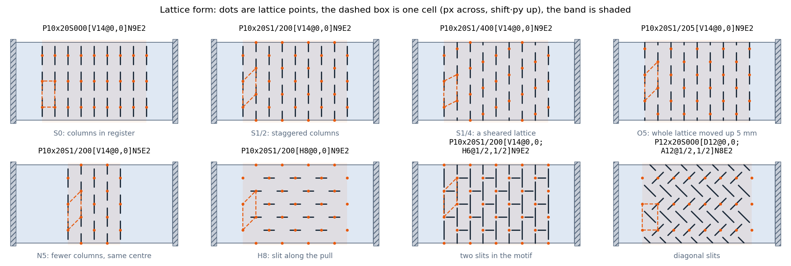

**The free form** places pieces directly in the sheet: slits, polyline cuts, cracks from the free
edges, holes, and solids added back inside holes. A `k` after a cut turns it into a slot of that
width.

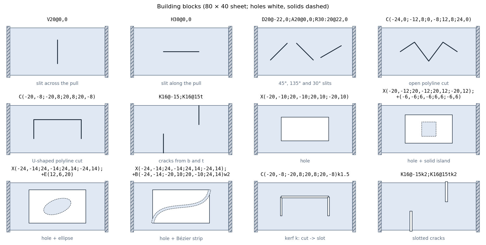

**Operations** copy pieces. Parentheses make a group, and a group can be mirrored (`{mx}`, `{my}`),
turned by half a turn (`{i}`) or repeated (`{t20x3}`). Orange is what was written, blue is what
the operation added.

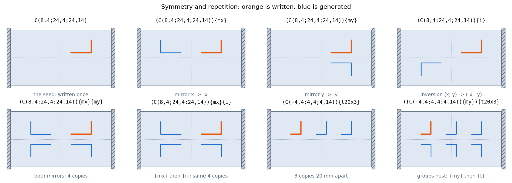

Together they keep strings short. The pitch actuator of the paper is one U-shaped cut and one
crack, each mirrored:

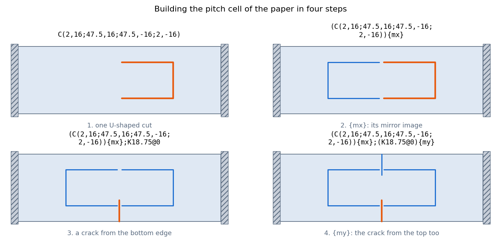

Every figure here is drawn by the parser from the string above its panel. The
[full notation](KIRISMILES.md) explains each part, with more examples.

- **Two forms.** The *lattice form* repeats a motif. The *free form* places pieces directly in the
  sheet and can apply symmetries: `(V40@6,0){mx}` is one slit plus its mirror image.
- **Context stays outside the string.** Sheet size, thickness and material are stored separately,
  just as SMILES leaves out conditions.
- **One design, one identity.** `canonical` normalises the spelling of a string. `geometry_key`
  hashes the cuts themselves, so different ways of writing the same pattern share a key, which
  plays the role InChIKey plays for molecules.
- **Validity checks.** `check` reports readable problems such as a ligament that is too narrow,
  crossing cuts, or a piece cut loose from the clamped ends.

```python
from kirigami import kirismiles as ks

ks.canonical("V40@6,0;V40@-6,0")                  # 'V40@-6,0;V40@6,0'
ks.geometry_key("(V40@6,0){mx}", 120, 60)         # 'b9b667f804fa'
ks.geometry_key("V40@-6,0;V40@6,0", 120, 60)      # 'b9b667f804fa', the same design
ks.pattern("(V40@6,0){mx}", L=120, W=60)          # {"cuts": [...], "holes": [...], "solids": [...]}
ks.check("V40@0,0;V40@0.8,0", 120, 60)            # ['ligament of 0.80 mm < 1 mm between cuts[0] and cuts[1] near (60.4, 10.0)']
```

Every configuration of the paper is one string
([the list](KIRISMILES.md#the-papers-configurations)), and `tests/test_kirismiles.py` checks that
each string cuts exactly what the matching generator in `kirigami/geometry.py` cuts:

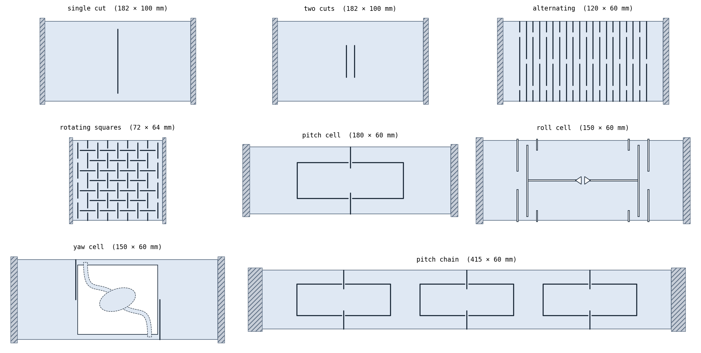

Designs from other papers are written the same way. A [corpus of 20 published designs](KIRISMILES.md#the-papers-configurations)
covers rotating squares and triangles, hierarchical cuts, kirigami skins and shells, a
machine-learning grid, graded and random patterns, and precursors of 3D assemblies, in 7 to 674
characters each (`specs/corpus/literature.json`, table in
[`results/corpus/corpus.md`](results/corpus/corpus.md)).

## 2. Generating structures

There are three ways to build a pattern, and they can be combined.

**From a string.** Lattices, symmetries (`{mx}`, `{my}`, `{i}`) and translated copies (`{t<p>x<n>}`)
are part of the notation.

**From a JSON spec.** New designs don't need Python. A design is a small JSON **spec**: sheet size,
material, a cut pattern, and optionally mesh, load and probe points. The pattern is a KiriSMILES
string, one of the built-in generators (`single_cut`, `two_cuts`, `pitch_cell`, `pitch_chain`,
`roll_cell`, `yaw_cell`, `alternating`, `rotating_squares`) with parameters, or explicit cuts,
holes and solids. Examples are in `specs/`, and the format is documented in `kirigami/spec.py`.

```json
{
  "name": "my_design",
  "sheet": {"L": 120, "W": 60},
  "pattern": {"generator": "kirismiles", "params": {"code": "P5x40S1/2O0[V36@0,0]N20E4"}},
  "material": {"E": 3500, "nu": 0.38, "h": 0.127},
  "boundary": {"type": "biaxial", "in_plane": false}
}
```

Only the name, sheet and pattern are required. The material defaults to the PET of the benchmark
and the loading to clamped ends; both can be set to whatever a study needs (see
[section 3](#3-simulation-engine-and-validation)).

**From Python.** `kirigami/geometry.py` provides `tile`, `translate`, `merge` and `clip_to_sheet`,
to build arrays from any unit pattern.

Designs can also be drawn by hand in the [web app](TOOLS.md#web-app-kirigami-fem-studio).

## 3. Simulation engine and validation

KiriSMILES is more than a grammar: every design it describes can be simulated with an open-source
engine built on [FEniCSx](https://fenicsproject.org). The engine meshes the cut sheet, applies the
loading, and follows the sheet through buckling and large rotations with a geometrically exact
Kirchhoff–Love shell (or a Föppl–von Kármán plate).

**Material.** Any isotropic elastic sheet: Young's modulus `E`, Poisson's ratio `nu` and thickness
`h` are part of the spec. The default is the PET sheet of *Kirigami Actuators*, which the benchmark
below uses.

**Loading.** The sheet is stretched by Δ along x; `spec["boundary"]` chooses how it is held:

| `type` | Edges | Use |
|---|---|---|
| `clamped` (default) | x = 0 fixed, x = L moved by Δ, no rotation at either end | tensile-tester grips, as in *Kirigami Actuators* |
| `roller` | the ends move only along x and may slide sideways and rotate | uniaxial stress |
| `biaxial` | all four edges move outward along their normals | equal-biaxial strain |

`"in_plane": true` holds the sheet flat and drops bending: a membrane model, the analogue of the
plane calculations often used for rotating-unit kirigami.

**Validation.** The engine reproduces the finite-element results of
[*Kirigami Actuators*](https://pubs.rsc.org/sm/article-abstract/13/48/9087/585682/Kirigami-actuators)
(Dias *et al.*, *Soft Matter* **13**, 9087 (2017)), co-authored by this project's maintainer, with the
paper's material and boundary conditions: the single cut, two interacting cuts, and the pitch,
roll and yaw actuators.

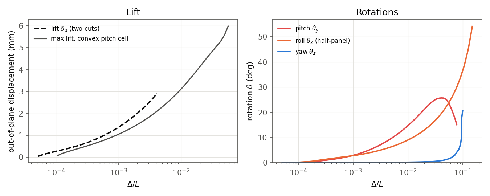

The new loading modes are checked on rotating-squares kirigami, the level-1 pattern of
Cho *et al.* (*PNAS* **111**, 17390 (2014)), written `P8x16S1/2O0[H12@0,0;V12@0,1/2]N9E4`. Under equal-biaxial load the panels counter-rotate
uniformly and the cut band strains equally in x and y; thinner hinges move the response toward
the rigid rotating-squares mechanism; and the out-of-plane buckling stretch scales as h², as
plate theory predicts.

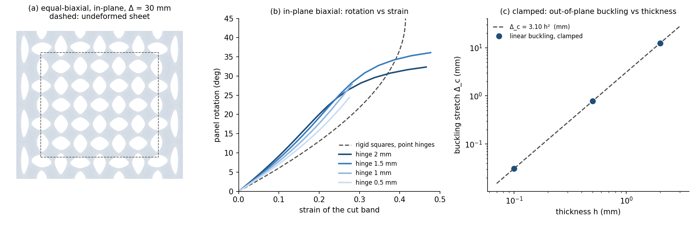

[`BENCHMARK.md`](BENCHMARK.md) has the models, the mesh, how to run every case, the comparisons
and the limits of each.

## 4. The KiriSMILES platform

The notation, the engine, the job queue and the results store make up one platform, and every
way in, for people or for agents, reaches the same operations and the same stored results.

The present version is meant to run locally, on your own computer or a machine shared by a
trusted group. A public service for the whole community would need more: accounts and roles,
a database for many users, separate machines for queries and for simulations, and backups.
The notation, the design identity and the operations are what such a service would build on.

- **Command line.** `scripts/kirigami_cli.py` validates, previews, simulates and exports designs,
  printing one line of JSON for each command.
- **Python API.** `kirigami/` can be used directly from your own scripts.
- **Web app.** Kirigami FEM Studio draws designs, runs the solver and shows the results.
- **MCP server.** Claude Code and other MCP clients can check, preview, simulate and export
  designs as tools. The repository's `.mcp.json` registers it for Claude Code; with `--http` it
  runs as one server for several clients, people or agents, at once.
- **Results stored by design.** Every run is found by the geometry key of its design, so a
  design that was already simulated with the same settings is returned without solving again.
- **One run engine.** The web app, the MCP server and batch scripts share one job queue
  (`kirigami/jobs.py`), which runs one solve at a time on the machine and keeps a record of every
  job.
- **Fabrication.** Laser-cut SVG/DXF and 3D-print STL files can be exported from any design.
- **In and out.** A laser-cut SVG or DXF can be imported as a string, so an existing design
  joins the platform in one step, and the finite element mesh of any design can be exported
  for other codes (gmsh, Abaqus, Nastran, VTK, XDMF), or as a MuJoCo model for robotics
  (below).

[`TOOLS.md`](TOOLS.md) has the commands and details.

### Kirigami in MuJoCo, for robotics

Any design can also be exported to [MuJoCo](https://mujoco.org), the physics engine used for robot
learning, where it can be put in a robot scene, simulated in many copies at once on a GPU
(MuJoCo Warp, MJX) for training or design sweeps, or used as a digital twin of a kirigami gripper or
skin. The design's mesh becomes a MuJoCo 2D flex shell, clamped at one end and held by a grip at the
other:

```bash
pip install "mujoco>=4.0.1"
python scripts/kirigami_cli.py mesh specs/<design>.json              # the design's mesh (mesh.vtk)
python scripts/export_mujoco.py --mesh results/runs/<name>/mesh.vtk --L 120 --nu 0.38 --out design.xml
```

`scripts/mujoco_check.py` computes MuJoCo's quasi-static force–strain curve of a design and compares
it with the FEniCSx engine, and `scripts/mujoco_gif.py` renders a gripper pulling the sheet.

**How far to trust it.** MuJoCo's flex is built for speed, not as a verified plate element. On an
uncut sheet with the FEniCSx fields imposed (`scripts/pristine_fenics.py`, `scripts/pristine_mujoco.py`),
MuJoCo 4.0.1 reproduces the in-plane stiffness exactly and simple bending within 2%, but its
bending has no Poisson coupling: twisting is 1.3× (ν = 0) to 2× (ν = 0.38) too stiff, and bending of
a plate with free edges up to 22% too stiff at ν = 0.38. The flex also has only linear triangles
(no quadrilaterals or quadratic elements) and no static solver, so a quasi-static pull is computed by
dynamic relaxation.

For the alternating pattern `P5x40S1/2O0[V36@0,0]N20E4` (PET, ν = 0.38):
- Before buckling, MuJoCo is 11% stiffer. About 5% of this comes from linear rather than quadratic
  elements, about 3% from the coarser mesh, and the rest from the clamp and the relaxation tolerance.
- Both codes buckle at the same strain.
- After buckling, the force is 24–26% higher in MuJoCo and the largest deflection 13–25% lower,
  with the same pattern of tilted flaps.
- MuJoCo's relaxation stops converging beyond 0.3% strain, so only that range is compared.

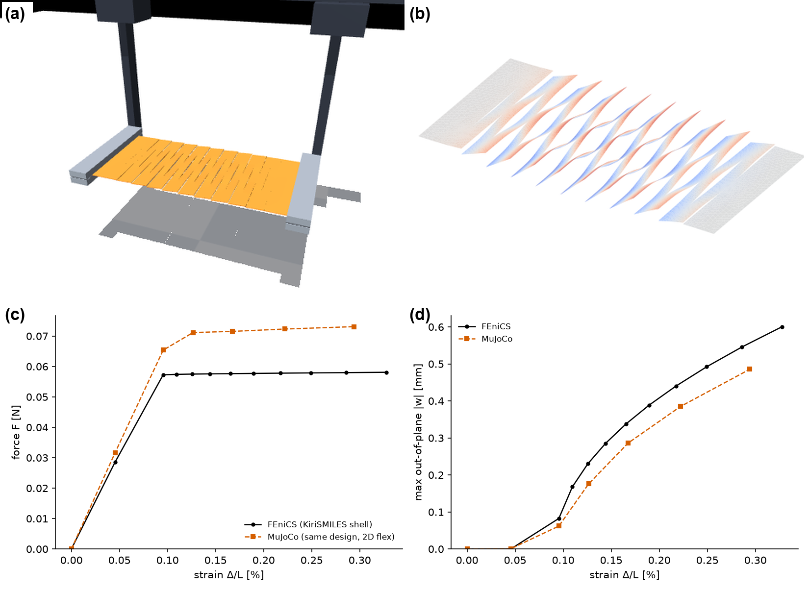

Use MuJoCo for robotics, dynamics and large-scale studies, and the FEniCSx engine for accurate forces
and large deformations. MuJoCo 3.x used different elastic constants; `kirigami/mjcf.py` maps them, so
either version can be used.

### Designing kirigami by talking to an AI assistant (MCP)

**What MCP is.** The [Model Context Protocol](https://modelcontextprotocol.io) is a standard way to
plug tools into an AI assistant. This repository includes an MCP server, so an assistant such as
[Claude Code](https://claude.com/claude-code) can check, draw, simulate and export kirigami
designs for you. You describe what you want in plain language; the assistant picks the tools,
runs them, and shows you the results. You do not need to learn the commands or the notation
first.

**Setting it up (once).**

1. Install the MCP Python package: `pip install "mcp>=2.3,<3"`.
2. Start Docker Desktop if you want simulations. Checking and drawing designs work without it.
3. Run `claude` in this repository. It finds the server through the repository's `.mcp.json` and
   asks you to approve "kirismiles": choose yes. Typing `/mcp` shows the server and its tools;
   press Esc to return to the prompt.

**Using it.** Type a request at the normal prompt. The first time the assistant uses a tool, it
asks for permission; you can allow the kirismiles tools for the rest of the session.

**An example session.** The request:

> *Check the alternating pattern `P5x40S1/2O0[V36@0,0]N20E4` on a 120 × 60 mm sheet, show me
> what it looks like, and simulate it to 10 % stretch.*

The tool calls an assistant makes for it, with the results of a real run through the server:

| Step | Tool | Result |
|---|---|---|
| 1 | `check_design` | valid: 50 cuts, geometry key `7acc55b51e60` |
| 2 | `preview_design` | a picture of the pattern (left below) |
| 3 | `buckle` | stiffness 0.523 N/mm; buckles out of plane at Δ_c = 0.109 mm (10 s) |
| 4 | `start_simulation` | job `7a8fe7e5` queued: Δ/L up to 10 % in 30 steps |
| 5 | `wait_for_job` (repeated) | progress reports (26 %, 49 %, 73 %, 97 %), then done after about 20 min |
| 6 | `show_run` | max lift 3.4 mm, final force 0.076 N; the final shape and stress–strain curve (below) |

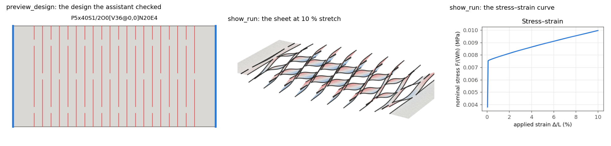

From these results the assistant can explain what happened: the slits open into a lattice of
tilted ribbons, the sheet becomes soft once it buckles, and the peak local strain stays below
the 2 % yield estimate all the way to 10 % stretch.

**More things to ask.**

- *"Design a pattern of staggered slits that is valid on a 100 × 50 mm sheet, and show it."*
- *"Why is `V30@0,0;H30@0,0` invalid, and how do I fix it?"*
- *"Preview the pitch cell from the samples, then make its ribbon 10 mm longer."*
- *"Compare the buckling stretch of these two designs."*
- *"Export laser-cut files for the design we just checked."*
- *"Turn my laser-cut file `my_cut.svg` into a string, check it, and simulate it."*
- *"Export the mesh of this design so I can run it in Abaqus."*
- *"Show me the results of my last simulation."*

Simulations take minutes and run one at a time; you can keep working while one runs, and it
keeps running even if you close the session. If the same design was already simulated with the
same settings, the stored result comes back at once instead.

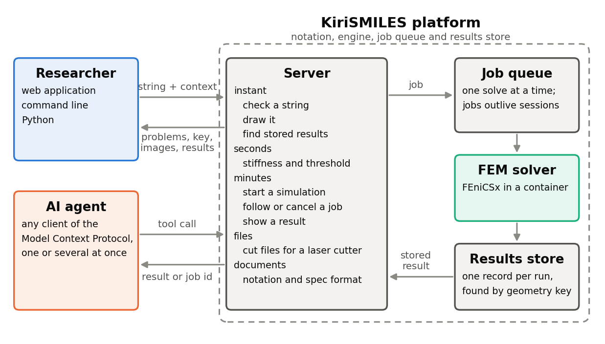

To keep one server running for several clients, start it with
`python mcp_server/server.py --http --port 8765` and connect each client with
`claude mcp add --transport http kirismiles http://127.0.0.1:8765/mcp`. It has no
authentication, so keep it on your own machine or a trusted network. [`TOOLS.md`](TOOLS.md#mcp-server-kirigami-tools-for-ai-assistants)
lists every tool and explains how jobs are run.

## Roadmap

- **Dataset.** One open table of simulated designs: string, geometry key, solver settings and
  results.
- **Stored or live results.** The API and web app will look up the geometry key and return a stored
  result when there is one, and otherwise run the solver.
- **Valid by construction.** A repair map that makes every lattice string a valid design, the
  property SELFIES brings to molecules.
- **More notation.** A full canonical form for free-form strings, curved cuts, non-rectangular
  sheet outlines (such as disks), and several lattice bands in one sheet.
- **Benchmark coverage.** The quantitative rotating-squares comparison with Cho *et al.*, and further published designs.
- **Solver.** Arc-length continuation, to follow runs through the stiff and snapping stretches
  where load-controlled Newton steps stall, and hyperelastic material laws for large local
  strains.
- **After the first release.** The framework will be used and extended for automated design
  search, such as a collective of search agents, as follow-up work.

## How to get involved

Kirigami informatics needs more than one group's designs. Ways to help:

- **Write your designs in KiriSMILES.** If the notation cannot express a design of yours, please
  open an issue with a figure or cut file: those cases decide how the notation grows.
- **Share designs and results.** Strings or specs from your papers, with simulated or measured
  results, are the start of the open dataset.
- **Propose and discuss extensions** to the notation, such as graded patterns or several lattice
  bands, in the issues.
- **Improve the software:** the solver and its benchmark, the checks, the tools, and the
  documentation.

## Who's behind the project?

KiriSMILES was started by Paul Z. Hanakata, a co-author of *Kirigami Actuators*, as the
open-source companion to that work, and is developed in the open. Contributors are welcome.

## Citing

There is no KiriSMILES paper yet. Until there is, please cite this repository
(<https://github.com/phanakata/kirismiles>) and, for the benchmark, Dias *et al.*,
*Soft Matter* **13**, 9087 (2017).

## References

- Dias *et al.*,
  [Kirigami actuators](https://pubs.rsc.org/sm/article-abstract/13/48/9087/585682/Kirigami-actuators),
  *Soft Matter* **13**, 9087 (2017).
- Cho *et al.*,
  [Engineering the shape and structure of materials by fractal cut](https://doi.org/10.1073/pnas.1417276111),
  *PNAS* **111**, 17390 (2014).
- Weininger, SMILES, *J. Chem. Inf. Comput. Sci.* **28**, 31 (1988).
- Krenn *et al.*, SELFIES, *Mach. Learn.: Sci. Technol.* **1**, 045024 (2020).
- Lejeune, Mechanical MNIST, *Extreme Mechanics Letters* **36**, 100659 (2020).

## License

[MIT](LICENSE).

SMILES is used here to describe the kind of notation. This project isn't affiliated with Daylight
Chemical Information Systems.

**Third-party software.** KiriSMILES uses, but does not include, the following. Their own
licences apply to them:

| Package | Licence |
|---|---|
| FEniCSx: DOLFINx, UFL, FFCx | LGPL-3.0-or-later |
| Basix | MIT |
| PETSc, SLEPc, petsc4py, slepc4py | BSD-2-Clause |
| MUMPS (in the FEniCSx container) | CeCILL-C |
| gmsh | GPL-2.0-or-later, with the Gmsh exception |
| NumPy, SciPy, mpi4py | BSD-3-Clause |
| Matplotlib | Matplotlib licence (PSF-based) |
| MCP Python SDK | MIT |

The solver runs in the official `dolfinx/dolfinx` container, which this repository does not
redistribute. Because the meshing calls gmsh's Python interface, anyone who distributes this
code bundled with gmsh must follow the GPL for that bundle; the KiriSMILES source itself remains
MIT. Abaqus, Nastran and COMSOL are trademarks of their owners; the mesh export only writes
files in their input formats, and no code or endorsement of theirs is involved.

**Use of AI tools.** Much of this code was written with Claude Code (Anthropic), directed and
checked by the author. Every change is covered by the tests in `tests/`, and every design in the
paper is checked by `scripts/check_strings.py`.

## Layout

```
BENCHMARK.md           validation of the simulation engine: models, mesh, loading, results, limits
TOOLS.md               command line, Python API, web app and MCP server
KIRISMILES.md          the notation: specification, with figures
kirigami/kirismiles.py  parse, canonical form, geometry key, validity checks
kirigami/grammar.py    lattice form of the notation: encode/decode, cut-set hash, features
kirigami/geometry.py   pattern generators, tiling, and gmsh meshing (slits, slots, windows)
kirigami/fvk.py        FvK plate: in-plane solve, linear buckling (SLEPc), post-buckling
kirigami/shell.py      geometrically exact Kirchhoff-Love shell (large rotations; clamped,
                       roller, biaxial and in-plane loading)
kirigami/strain.py     local material strain (membrane + bending) from displacement snapshots
kirigami/spec.py       JSON design specs: format, defaults, validation
kirigami/api.py        buckle / simulate / export / mesh from a spec (runs in the container)
kirigami/export.py     laser-cut SVG/DXF and 3D-print STL
kirigami/importer.py   laser-cut SVG/DXF back to a KiriSMILES string (curves, units, nesting)
kirigami/jobs.py       run engine: job queue, one solve at a time, job records, orphaned-run recovery
kirigami/mjcf.py       a design's mesh as a MuJoCo 2D flex (MJCF); MuJoCo 3.x/4.x material inputs
scripts/kirigami_cli.py  one JSON-in/JSON-out entry point for people and agents
webapp/                local web app (server.py + static/index.html): samples, editor, run, GIF
mcp_server/server.py   MCP server: the tools for AI assistants (registered in .mcp.json)
scripts/               paper-reproduction drivers, plotting, GIF rendering
specs/                 example design specs
specs/rs_thickness/    rotating-squares validation runs (thickness, loading, hinge width)
specs/star/            multistable star pattern runs (three hinge widths, neo-Hookean membrane)
specs/corpus/          20 kirigami designs from the literature as strings (scripts/corpus.py,
                       scripts/corpus_tex.py for a LaTeX table, scripts/make_piecewise_corpus.py
                       for the graded and random-link strings)
scripts/export_mujoco.py  a design's mesh -> MuJoCo model (MJCF)
scripts/mujoco_check.py   MuJoCo vs FEniCSx force-strain of a design (dynamic relaxation), figure
scripts/mujoco_gif.py     GIF of a gripper pulling the sheet in MuJoCo
scripts/pristine_*.py     uncut-sheet check of MuJoCo's membrane, bending and twist against FEniCSx
results/mujoco_check/  MuJoCo comparison data, figures and GIFs
scripts/verify/        rigid-unit mode counts that check the hierarchical (fractal) cut strings
tests/                 tests of the notation, the import, the run engine, the MCP server and the MuJoCo export
scripts/check_strings.py  every simulated design survives geometry -> string -> geometry
results/single_cut/    Fig. 2 data and figures
results/configs/       multi-cut data (.npz), GIFs and figures
results/kirismiles/    figures of KIRISMILES.md (scripts/plot_kirismiles.py,
                       scripts/plot_notation_buildup.py)
results/rotating_squares/  rotating-squares check (scripts/plot_rotating_squares.py)
results/corpus/        corpus table and figure (scripts/corpus.py)
results/tools/         figures of TOOLS.md (scripts/plot_api_workflow.py, screenshot_webapp.py)
results/runs/<name>/   outputs of CLI runs (spec, JSON summaries, cut files, GIFs)
run.sh                 runs a command in the FEniCSx container
requirements.txt       Python packages for the host side (the solver is in Docker)
```
