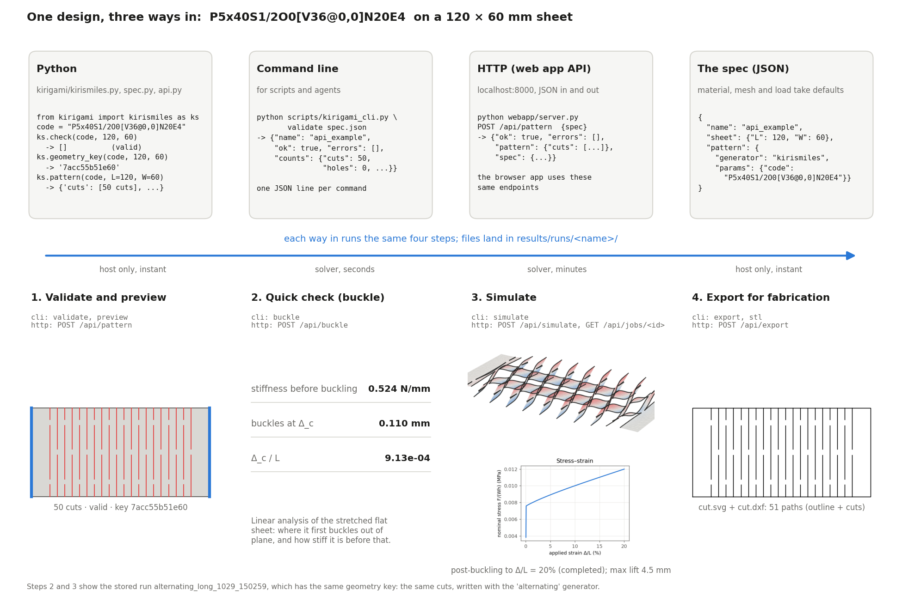
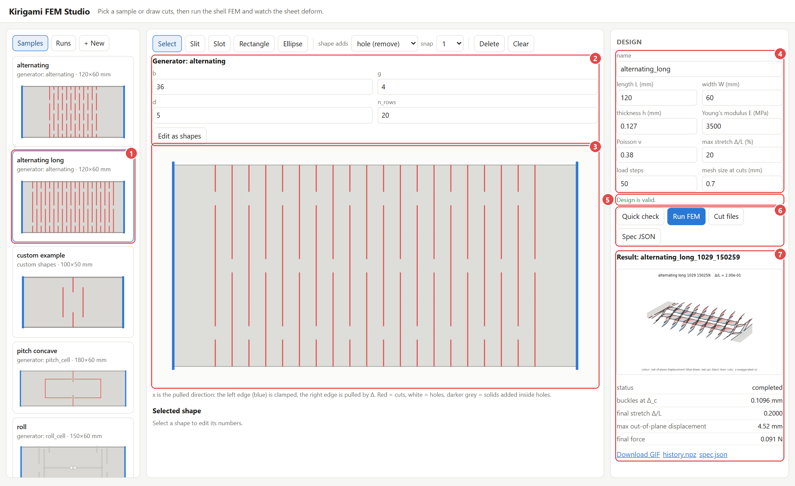
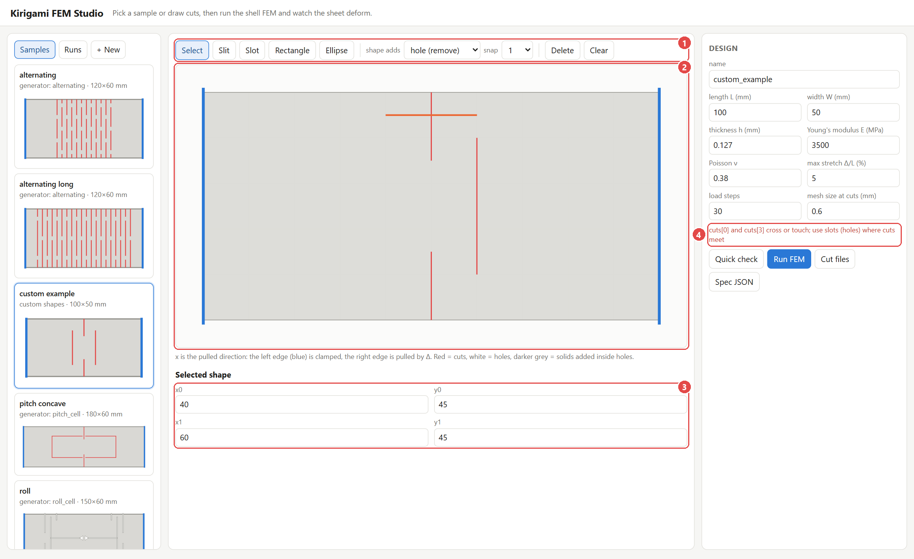

# Tools

The command line, Python API, web app and MCP server. See the [README](README.md) for an
overview.

Each is a way into the same steps: validate a design, run a quick buckling check, run the
full simulation, and export cut files. The figure follows one design through all four.



The pattern and cut file in the figure are computed from the string. The buckling and simulation
panels show a stored run of the same design (same geometry key).

## A design is a spec

Every tool takes a small JSON **spec**. Only the name, the sheet and the pattern are required;
material, mesh, load, boundary conditions and probe points take defaults. The material
(`E`, `nu`, `h`) is the user's choice; the default is the PET of the benchmark. The loading
(`boundary`) is `clamped`, `roller` or `biaxial`, optionally held in plane
([details](BENCHMARK.md#models)). The format is documented in `kirigami/spec.py`, and examples
are in `specs/`.

```json
{
  "name": "api_example",
  "sheet": {"L": 120, "W": 60},
  "pattern": {"generator": "kirismiles", "params": {"code": "P5x40S1/2O0[V36@0,0]N20E4"}}
}
```

The pattern can be a [KiriSMILES](KIRISMILES.md) string as here, a built-in generator with
parameters (`python scripts/kirigami_cli.py generators` lists them), or explicit cuts, holes and
solids.

## Command line

```bash
python scripts/kirigami_cli.py validate specs/alternating.json   # cheap checks
python scripts/kirigami_cli.py preview  specs/alternating.json   # pattern.png
python scripts/kirigami_cli.py buckle   specs/alternating.json   # seconds: stiffness, Δ_c, F_c
python scripts/kirigami_cli.py simulate specs/alternating.json   # minutes: post-buckling + GIF
python scripts/kirigami_cli.py export   specs/yaw.json           # cut.svg + cut.dxf for a laser cutter
python scripts/kirigami_cli.py stl      specs/x.json --thickness 0.5 --kerf 0.4   # for 3D printing
python scripts/kirigami_cli.py import   my_cut.svg --spec specs/mine.json   # a cut file as a string
python scripts/kirigami_cli.py mesh     specs/mine.json          # the FEM mesh for other codes
```

Every command prints one line of JSON. For the spec above:

```
$ python scripts/kirigami_cli.py validate api_example.json
{"name": "api_example", "ok": true, "errors": [], "counts": {"cuts": 50, "holes": 0, "solids": 0}}

$ python scripts/kirigami_cli.py preview api_example.json
{"name": "api_example", "ok": true, "files": ["results/runs/api_example/pattern.png"]}

$ python scripts/kirigami_cli.py export api_example.json
{"name": "api_example", "ok": true, "n_paths": 51, "files": ["results/runs/api_example/cut.svg", "results/runs/api_example/cut.dxf"]}
```

- **Output.** Each command writes its files, plus a copy of the spec, to
  `results/runs/<name>/`. One JSON line per command makes the CLI usable as a tool by scripts
  and AI agents: check `"ok"`, and read `"errors"` when it is false.
- **Where commands run.** The solver commands run in the FEniCSx container automatically.
  `validate`, `preview` and `export` of slit-only patterns need only numpy and matplotlib.
- **Exact cut files.** Patterns with solids, such as the yaw leaf, are exported with gmsh
  booleans. The cut file is then exactly the simulated shape: internal seams left by
  fusing are not cut.
- **Importing a cut file.** `import` reads an SVG or DXF (lines, polylines, rectangles,
  paths, circles, ellipses, arcs, Bezier curves and DXF bulges, with units and transforms)
  and writes it as a KiriSMILES string. The sheet is the closed rectangle around the drawing,
  or give `--L` and `--W`. Open curves become cuts and closed curves holes; a closed curve
  inside a hole becomes a solid. Curves are replaced by polylines within `--tol` mm (default
  0.01) and coordinates are rounded to `--digits` decimals (default 3). The result reports
  the counts, `max_deviation_mm` (the string's geometry against the file) and any validity
  problems; `--spec` also writes a spec, ready for `preview`, `mesh` or `simulate`. Every
  design in the paper survives export to SVG or DXF and import back to within 0.001 mm.
- **Exporting the mesh.** `mesh` writes the finite element mesh exactly as the solver uses
  it: `mesh.msh` (gmsh), `mesh.inp` (Abaqus, CPS3), `mesh.bdf` (Nastran, CTRIA3), `mesh.vtk`
  and `mesh.xdmf`. The elements are linear triangles in mm, and the nodes along every cut
  are already duplicated, so the two lips of a cut are free edges. The `.msh` also keeps the
  cut lines (physical group 10) and the cut mouths at free edges (11).

## Python API

```python
from kirigami import kirismiles as ks

code = "P5x40S1/2O0[V36@0,0]N20E4"
ks.check(code, 120, 60)              # []: the design is valid
ks.geometry_key(code, 120, 60)       # '7acc55b51e60': its identity
pat = ks.pattern(code, L=120, W=60)  # {"cuts": [50 polylines], "holes": [], "solids": []}
```

- `kirigami/kirismiles.py`: parse, label, check and convert strings.
- `kirigami/spec.py`: load and validate JSON specs.
- `kirigami/api.py`: buckle, simulate and export from a spec. It runs in the solver container; the
  command line starts that for you.
- `kirigami/export.py`: laser-cut SVG/DXF and 3D-print STL.

## Web app: Kirigami FEM Studio

```bash
python webapp/server.py        # then open http://localhost:8000   (Docker must be running)
```

### Starting from a sample



1. **Samples.** A gallery of every spec in `specs/`. Click one to load it. The **Runs** tab
   lists previous results, and **+ New** starts an empty sheet.
2. **Generator parameters.** Generator-based samples show their parameters as a form. Editing a
   parameter redraws the pattern. **Edit as shapes** turns the sample into freely editable
   geometry.
3. **The sheet.** Red lines are cuts, white areas are holes, and darker grey areas are solids
   added back inside holes. The blue edges are the clamped end (left) and the pulled end
   (right).
4. **Settings.** Sheet size, thickness, material, maximum stretch, load steps and mesh size.
5. **Live check.** The design is validated as you edit.
6. **Actions.**
   - **Quick check** (seconds): stiffness and buckling threshold.
   - **Run FEM** (minutes): the full shell simulation, with a progress bar.
   - **Cut files**: laser-cut SVG/DXF of the current design.
   - **Spec JSON**: download the design, to run it later from the command line.
7. **Result.** When a run finishes: the deformation GIF, the key numbers, and downloads (GIF,
   `history.npz`, `spec.json`). A new run also shows the stress–strain plot and the
   stretchability estimate. The result shown is the stored run of this design, as the
   Runs tab shows it.

### Drawing your own



1. **Tools.** Slits (zero-width cuts), slots (cuts with width, for places where cuts meet), and
   rectangles or ellipses. **shape adds** sets whether a rectangle or ellipse is a hole or a solid
   added back inside a hole. Shapes snap to the grid set by **snap**.
2. **Canvas.** With a drawing tool, drag to draw a shape. With **Select**, click a shape to
   select it and drag to move it. Delete removes the selected shape.
3. **Selected shape.** The exact numbers of the selected shape, in mm, for precise editing.
   Here one slit was turned horizontal so that it runs into an edge crack.
4. **Live check.** The crossing is reported at once: zero-width cuts may not meet, so where they
   do, use slots.

Runs are queued and solved one at a time. A job also waits while any other solver container
of this project is running, so the machine's memory is never split between two solves. The
server uses only the Python standard library on top of this project's host modules, so
there is nothing extra to install.

### HTTP API

The browser app is a client of a small JSON API, which scripts can use directly:

| Method and path | Body | Returns |
|---|---|---|
| `GET /api/samples` | | the specs in `specs/`, with their geometry |
| `GET /api/generators` | | the pattern generators and their parameters |
| `POST /api/pattern` | spec | `{"ok", "errors", "pattern", "spec"}`: validation and geometry |
| `POST /api/buckle` | spec | stiffness, Δ_c and F_c (seconds, synchronous) |
| `POST /api/simulate` | spec | `{"ok", "job", "name"}`: a queued full run |
| `GET /api/jobs/<id>` | | job state, progress, and the result when done |
| `POST /api/jobs/<id>/cancel` | | stops a queued or running job |
| `POST /api/export` | spec | links to the laser-cut SVG and DXF |
| `GET /api/runs` | | previous runs with their summaries and GIFs |
| `GET /files/<name>/<file>` | | any file of a run, from `results/runs/` |

```bash
curl -s -X POST localhost:8000/api/pattern -H "Content-Type: application/json" -d @api_example.json
# {"ok": true, "errors": [], "pattern": {"cuts": [...50 cuts...], "holes": [], "solids": []}, "spec": {...}}
```

The server listens on `127.0.0.1` by default. `--host 0.0.0.0` opens it to other machines, but
there is no authentication, so do that only on a trusted network.

## MCP server: kirigami tools for AI assistants

The [Model Context Protocol](https://modelcontextprotocol.io) (MCP) is a standard way to give an AI
assistant tools. `mcp_server/server.py` offers this project's design and simulation steps as
tools, so an assistant such as Claude Code can check, preview, simulate and export designs
directly, instead of composing shell commands. By default the assistant starts the server
itself and talks to it over stdin/stdout, with no network port. The server can also run on its
own over HTTP, so that one server stays up for several clients, people or agents, at once
([below](#one-server-for-several-clients-http)).

### Setting it up for Claude Code

```bash
pip install "mcp>=2.3,<3"      # the MCP Python SDK, into the Python that `python` runs
claude                         # in this repository: approve the "kirismiles" server when asked
```

The repository's `.mcp.json` registers the server, so nothing else is needed. Inside a session,
`/mcp` shows its status and tools. The design tools need only Python; `buckle` and the simulation
tools need Docker running.

### Tools

| Tool | Speed | What it does |
|---|---|---|
| `check_design` | instant | validity problems, canonical string, geometry key and counts of a KiriSMILES design |
| `preview_design` | instant | the pattern as an image |
| `list_samples` | instant | the example designs in `specs/` |
| `export_cut_files` | instant | laser-cut SVG and DXF |
| `import_cut_file` | instant | a laser-cut SVG or DXF (a path, or the file's text) as a KiriSMILES string, with its sheet size, deviation and validity problems |
| `export_mesh` | seconds | the finite element mesh for other codes: gmsh, Abaqus, Nastran, VTK and XDMF |
| `buckle` | seconds | stiffness, buckling stretch Δ_c and force F_c |
| `start_simulation` | minutes | queues a full simulation and returns a job id; sets the material (`thickness_mm`, `E_MPa`, `nu`) and loading (`boundary`: clamped, roller or biaxial; `in_plane`) |
| `job_status`, `wait_for_job` | instant, or up to 5 min | the job's progress, and its results when done |
| `cancel_job`, `list_jobs` | instant | stop a job; recent jobs from every front end |
| `list_runs`, `show_run` | instant | finished runs; a run's summary, final shape and stress–strain plot |
| `find_runs` | instant | stored simulations of this design, found by its geometry key (so the same design written another way, or mirrored, is found too), with their thickness, boundary and whether they completed |

Every design tool takes a KiriSMILES string with the sheet size (`code`, `L`, `W`) or a full JSON
spec (`spec`). Two resources hold the reference material: `kirismiles://notation` (this
repository's `KIRISMILES.md`) and `kirismiles://spec-format`.

A typical request is *"design a pattern of staggered slits on a 120 × 60 mm sheet, check it, and
simulate it to 10 % stretch"*. The assistant writes the string, runs `check_design` and
`preview_design`, fixes any problems, calls `start_simulation`, follows the job with
`wait_for_job`, and finally looks at the result with `show_run`.

**Results are reused by design.** Before queuing a job, `start_simulation` looks for a completed
run of the same design (same geometry key) with the same sheet, material, mesh, boundary and
load. If there is one, it returns that run at once, marked `"reused": true`, and nothing is
solved; pass `reuse=False` to solve again. `find_runs` lists every stored run of a design,
including those with other settings.

### One server for several clients (HTTP)

```bash
python mcp_server/server.py --http --port 8765           # keep this running
claude mcp add --transport http kirismiles http://127.0.0.1:8765/mcp   # in each client
```

The server then stays up between sessions and serves several clients at once: Claude Code in
two terminals, an agent framework, or your own script through the MCP client library. All of
them share the one job queue below, so their simulations still run one at a time, and a result
computed for one client is reused for the others. The project's `.mcp.json` still starts a
private stdio server; remove that entry, or name the HTTP one differently, if you use both.

The HTTP server has **no authentication**: anyone who can reach the port can queue simulations.
It listens on `127.0.0.1` (this machine only) by default; use `--host 0.0.0.0` only on a network
you trust.

### Simulations: one run engine for every front end

The web app, the MCP server and batch scripts all run simulations through `kirigami/jobs.py`:

- **One solve at a time on the machine.** A solve holds a lock file (`results/runs/.solver.lock`),
  so jobs from the web app and from an assistant queue behind each other instead of splitting
  the memory. The operating system releases the lock if a process exits, so it cannot get stuck.
- **A record for every job** in `results/runs/<name>/job.json`. Any front end can read it:
  `list_jobs` in the MCP server also shows jobs started from the web app.
- **Runs outlive their session.** If the assistant session ends during a simulation, the solver
  keeps running in its container. Asking for the job later reports it as still running, finishes
  it (GIF and stress–strain plot) once the solver is done, or marks it interrupted.

The web app is the demo front end; heavy batches of simulations, for example from automated
design search, go through the same engine without the web app running.

### Troubleshooting

- **The server does not start.** Check `python -c "import mcp"` in the repository, and
  `claude mcp get kirismiles` for its status.
- **"Docker is not running".** Start Docker Desktop; the design tools work without it.
- **Testing without Claude Code.** `python -m pytest -q tests/test_mcp_server.py` starts the
  server and calls its tools through the MCP client.
- **A simulation returns at once with `"reused": true`.** A stored run of the same design and
  settings was found; `show_run` shows it. Pass `reuse=False` to solve again, for example after
  changing the solver.

## Regenerating the figures

```bash
python scripts/plot_api_workflow.py    # results/tools/api_workflow.png
python scripts/plot_server_schematic.py   # results/engine/server.png (the KiriSMILES platform)
python scripts/screenshot_webapp.py    # results/tools/webapp_*.png (needs Chrome or Edge, websocket-client)
```
