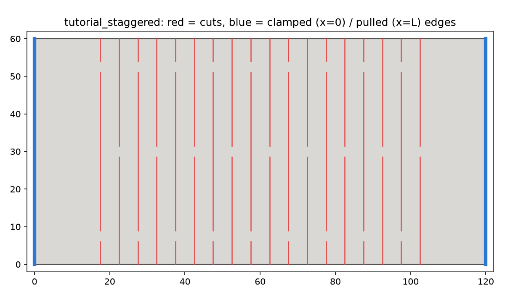

# Tutorials

Three walkthroughs of the same job, each from start to finish, with the real output of each
step. Pick the one that suits you:

| Walkthrough | For | Extra setup after [installation](../README.md#installation) |
|---|---|---|
| [Command line](command_line.md) | people at home in a Linux-style terminal | none |
| [Web app](web_app.md) | people who prefer to click and see the design as they go | none: start the app |
| [AI assistant (MCP)](ai_assistant.md) | people who would rather describe what they want in words | the MCP package and an assistant such as Claude Code |

All three use Docker for the simulation itself (Docker Desktop on Windows and macOS): start it
before step 3.

## The job

A sheet of PET, 120 mm long, 60 mm wide and 0.127 mm thick, is cut with rows of staggered
slits. Its left end is clamped and its right end is pulled by 6 mm (5 % stretch). We want to
know how stiff the sheet is, before and after the slits buckle out of plane.



In the KiriSMILES notation this design is one line:

```
P5x45S1/2O0[V42@0,0]N18E3
```

a 42 mm slit across the pull (`V42`), repeated on a 5 mm × 45 mm lattice (`P5x45`) whose
columns are shifted by half a cell (`S1/2`), 18 columns (`N18`), dropping edge pieces shorter
than 3 mm (`E3`). [KIRISMILES.md](../KIRISMILES.md#lattice-form) explains the notation.

## The five steps

| Step | Command line | Web app | AI assistant |
|---|---|---|---|
| 1. Describe the design and its settings | write a JSON spec | type the string, fill in the form | say it in words |
| 2. Check it | `kirismiles validate`, `preview`, `buckle` | live check, **Quick check** | `check_design`, `preview_design`, `buckle` |
| 3. Simulate | `kirismiles simulate` | **Run FEM** | `start_simulation` |
| 4. Follow it | the progress table, `log.txt` | the progress bar | `job_status`, `wait_for_job` |
| 5. Analyse | `fit_stiffness.py` and the files | the result panel | `show_run`, and the assistant runs the fit |

Every route stores its results the same way, in `results/runs/<name>/`, so a run started from
one can be opened from the others.
