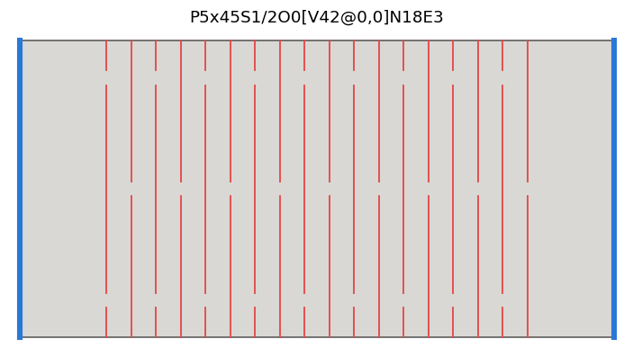
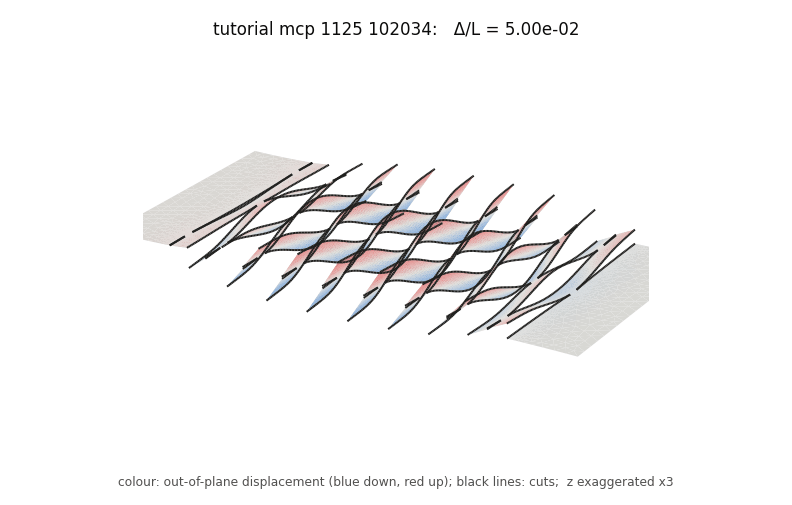
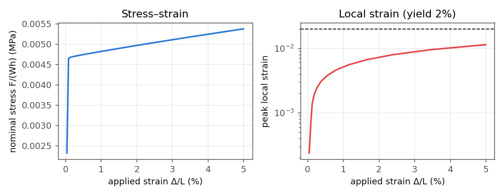
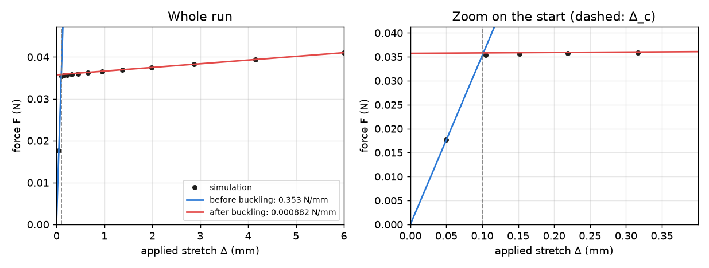

# Tutorial: an AI assistant (MCP)

This walkthrough stretches the staggered-slit sheet of the [tutorials page](README.md) by 5 %
and finds its stiffness, by asking an AI assistant in plain language. The assistant does the
work through the project's MCP server: a set of tools (check a design, draw it, simulate it,
show the result) that it can call.

For each step below you will find what you type, the tool the assistant calls, and what the
tool returned in a real run. The tool results are exact; the assistant's own replies are worded
differently every time, so they are summarised.

## Setup (once)

1. Install the code as in the [README](../README.md#installation), then add the MCP package
   to the same environment:

   ```bash
   source .venv/bin/activate          # Windows Git Bash: source .venv/Scripts/activate
                                      # Windows PowerShell: .venv\Scripts\Activate.ps1
   pip install -e ".[mcp]"
   python -c "import mcp; print('MCP package OK')"
   ```

2. Install [Claude Code](https://claude.com/claude-code), the assistant used here. Other MCP
   clients work too; see [TOOLS.md](../TOOLS.md#mcp-server-kirigami-tools-for-ai-assistants).
3. Start Docker Desktop. Checking and drawing designs work without it; simulations need it.
4. In the same terminal, with the environment still active, start the assistant in the
   `kirismiles` folder:

   ```bash
   claude
   ```

   The repository's `.mcp.json` tells Claude Code to start the server with `python
   mcp_server/server.py`, so `python` must be the environment's Python: start `claude` from a
   terminal where the environment is active. On the first start, Claude Code asks whether to
   use the "kirismiles" server: choose yes.
5. Type `/mcp` to check: it lists the kirismiles server and its tools. Press Esc to go back.

The first time the assistant calls a kirismiles tool it asks for your permission; you can allow
the kirismiles tools for the rest of the session.

## 1. Describe the design

Say what you want, with the sheet, material, boundary and load:

> *I want to simulate a kirigami sheet, 120 mm long and 60 mm wide, made of PET 0.127 mm thick
> (E = 3500 MPa, ν = 0.38), cut with staggered slits `P5x45S1/2O0[V42@0,0]N18E3`. Both ends
> are clamped and the sheet is pulled by 5 % in 12 load steps. First check the design and show
> it to me.*

You do not have to know the notation: *"rows of 42 mm slits across a 120 × 60 mm sheet,
staggered by half a row, 5 mm apart"* also works, and the assistant writes the string, reading
the notation from the server. Here the string is given, so the run matches the other
tutorials.

## 2. Check it

The assistant calls **`check_design`** (instant) and **`preview_design`**:

```json
check_design  {"code": "P5x45S1/2O0[V42@0,0]N18E3", "L": 120, "W": 60}
{
  "valid": true,
  "problems": [],
  "canonical": "P5x45S1/2O0[V42@0,0]N18E3",
  "geometry_key": "e52a11d38bdc",
  "counts": {"cuts": 45, "holes": 0, "solids": 0}
}
```



The **geometry key** is the design's identity: the same cuts written another way get the same
key, and stored results are found by it. When a design is not valid, `problems` says why (for
example, crossing slits or a ligament narrower than 1 mm), and the assistant can fix it.

Then ask for the quick check:

> *How stiff is it before it buckles, and when does it buckle?*

The assistant calls **`buckle`** (about 10 s, needs Docker):

```json
buckle  {"code": "P5x45S1/2O0[V42@0,0]N18E3", "L": 120, "W": 60, "thickness_mm": 0.127, "name": "tutorial_mcp"}
{
  "ok": true, "name": "tutorial_mcp", "analysis": "buckle", "n_cells": 31386,
  "stiffness_N_per_mm": 0.3526782069679313,
  "Delta_c_mm": 0.09998007048050003,
  "strain_c": 0.000833167254004167,
  "F_c_N": 0.035260791989590146,
  "Delta_c_higher_modes_mm": [0.11255105946730608, 0.1294865156775403, 0.1469904400310754, 0.16556523772372467],
  "seconds": 6.1
}
```

The assistant reports: the sheet is a 0.353 N/mm spring until it buckles out of plane at a
stretch of only 0.1 mm (0.08 % strain), so almost the whole 6 mm pull happens after buckling.

## 3. Simulate

> *Run the simulation.*

The assistant calls **`start_simulation`** with your settings:

```json
start_simulation  {"code": "P5x45S1/2O0[V42@0,0]N18E3", "L": 120, "W": 60, "max_stretch": 0.05, "steps": 12,
                   "thickness_mm": 0.127, "E_MPa": 3500, "nu": 0.38, "boundary": "clamped", "name": "tutorial_mcp"}
{
  "ok": true,
  "reused": false,
  "id": "965db042",
  "name": "tutorial_mcp_1125_102034",
  "state": "queued",
  "message": "waiting in queue",
  "steps": 0, "progress_percent": 0, "delta_mm": 0.0
}
```

It returns at once with a job id; the simulation runs in the background, one at a time on
this computer, and keeps running even if you close the session. The run is stored in
`results/runs/tutorial_mcp_1125_102034/` (the name plus the date and time).

**Stored results are reused.** If this design was already simulated with the same settings,
for example in the [command line](command_line.md) or [web app](web_app.md) tutorial, the
stored result comes back at once instead, and nothing is solved:

```json
{
  "ok": true, "reused": true, "state": "done", "name": "tutorial_staggered",
  "geometry_key": "e52a11d38bdc", "status": "completed", "same_settings": true,
  "max_stretch": 0.05, "max_out_of_plane_mm": 2.5671622810612584,
  "note": "stored result of the same design and settings; show_run(name) shows it"
}
```

To solve again anyway, say so (*"run it again, don't reuse the stored result"*); the
assistant then passes `reuse: false`.

## 4. Follow it

> *How is it going?*

The assistant calls **`job_status`** (an instant answer) or **`wait_for_job`**, which waits up
to a set time and then reports. In this run it waited three times:

```json
wait_for_job  {"job_id": "965db042", "timeout_s": 300}
{"id": "965db042", "state": "running", "message": "meshing and solving", "steps": 5, "progress_percent": 39, "delta_mm": 0.3164}

wait_for_job  {"job_id": "965db042", "timeout_s": 300}
{"id": "965db042", "state": "running", "message": "meshing and solving", "steps": 11, "progress_percent": 85, "delta_mm": 2.8753}

wait_for_job  {"job_id": "965db042", "timeout_s": 300}
{
  "id": "965db042", "name": "tutorial_mcp_1125_102034", "state": "done", "message": "completed",
  "steps": 13, "progress_percent": 100, "delta_mm": 6.0,
  "result": {
    "status": "completed",
    "buckles_at_Delta_c_mm": 0.09998007048050003,
    "stiffness_N_per_mm": 0.3526782069679313,
    "final_stretch_Delta_over_L": 0.05,
    "max_out_of_plane_mm": 2.5671622810612584,
    "final_force_N": 0.0409835774124397,
    "stiffness_before_buckling_N_per_mm": 0.35270581919846417,
    "stiffness_after_buckling_N_per_mm": 0.0008815860384972367,
    "stiffness_fit_range_pct": [1.0, 5.0],
    "stretchability": 0.05,
    "stretchability_note": "not reached within the simulated range",
    "files": ["results/runs/tutorial_mcp_1125_102034/spec.json", "...", "results/runs/tutorial_mcp_1125_102034/stress_strain.png"]
  }
}
```

The run took about 12 minutes. Meanwhile you can keep asking other things, for example to
check another design. *"Cancel the simulation"* calls `cancel_job`, and *"What jobs are
running?"* calls `list_jobs`, which also shows jobs started from the web app.

## 5. Analyse

> *Show me the result. What is the stiffness before and after buckling?*

The assistant calls **`show_run`**, which returns the summary, the stiffness fitted to the force
history, the spec, and two pictures:

```
stiffness, fitted to the force history (N/mm): {"k_before_N_per_mm": 0.35270581919846417, "n_before": 1,
  "k_after_N_per_mm": 0.0008815860384972367, "F0_N": 0.03572394200992695, "n_after": 5,
  "fit_from_pct": 1.0, "fit_to_pct": 5.0}
```





From these the assistant can explain the result:

- Before buckling the sheet is a stiff spring, **0.353 N/mm**, the same as the quick check.
- At 0.1 mm stretch the ligaments between the slits buckle and tilt out of plane (up to
  2.57 mm, the picture), and the force almost stops rising: the stress–strain curve turns flat.
- After buckling the sheet is **0.00088 N/mm**, about 400 times softer: the pull mostly rotates
  the ligaments instead of stretching them.
- The peak local strain stays below the 2 % yield strain of PET (right plot), so the sheet stays
  elastic up to 5 %.

**A plot of the fit.** In Claude Code the assistant can also run the project's scripts. Ask
*"Plot the force against the stretch with both stiffness fits"*, and it runs (after asking you)

```console
$ python tutorials/fit_stiffness.py tutorial_mcp_1125_102034
buckling at Delta_c = 0.1000 mm (strain 0.083 %)
stiffness before buckling  k0 = 0.3527 N/mm   (1 step below Delta_c)
stiffness after buckling   k  = 0.0008816 N/mm   (fit over 5 steps, 1 to 5 % strain; F0 = 0.03572 N)
the sheet is 400 times softer once it has buckled
wrote results/runs/tutorial_mcp_1125_102034/stiffness.png
```



## More to ask

- *"Make the slits 36 mm long instead and compare the stiffness after buckling."*
- *"Find all stored simulations of this design."* (`find_runs`)
- *"Export laser-cut files for this design."* (`export_cut_files`)
- *"Show me the results of my last simulation."* (`list_runs`, `show_run`)

The [README](../README.md#designing-kirigami-by-talking-to-an-ai-assistant-mcp) has more
examples, and [TOOLS.md](../TOOLS.md#mcp-server-kirigami-tools-for-ai-assistants) lists every
tool.
