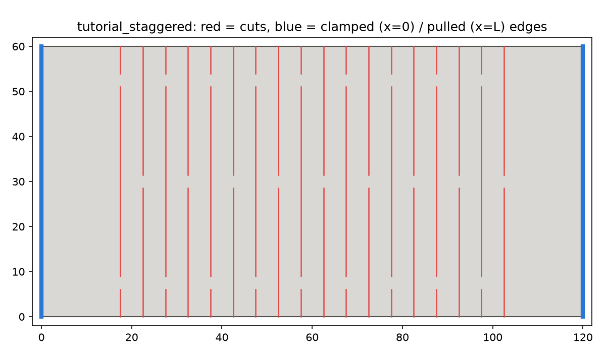
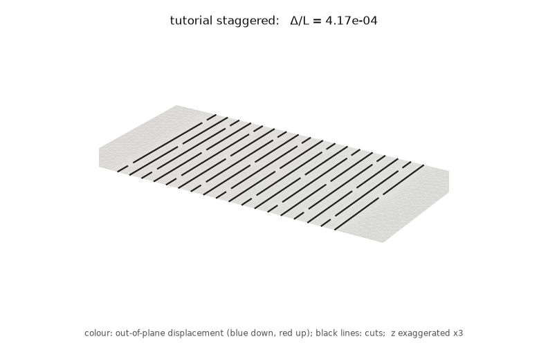
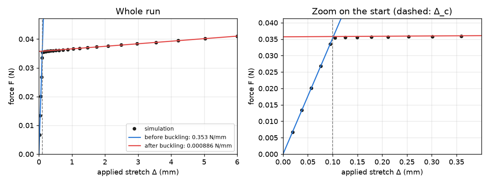

# Tutorial: the command line

This walkthrough stretches the staggered-slit sheet of the [tutorials page](README.md) by 5 %
and measures its stiffness, using only the terminal. Every output below is the real output of
these commands.

**Before you start.** Install the code as in the [README](../README.md#installation), with
`pip install -e .`, so that the `kirismiles` command exists. Start Docker before step 3. Then
open a terminal in the `kirismiles` folder and activate the environment:

```bash
source .venv/bin/activate          # Windows Git Bash: source .venv/Scripts/activate
kirismiles --help                  # lists the commands
docker info > /dev/null && echo "Docker is running"
```

All paths below are relative to the `kirismiles` folder.

## 1. Describe the design: a JSON spec

A **spec** is a small JSON file that says everything about one simulation: the sheet, the
cuts, the material, how the sheet is held, and how far it is pulled. Create
`tutorial_staggered.json`:

```bash
cat > tutorial_staggered.json <<'EOF'
{
  "name": "tutorial_staggered",
  "sheet": {"L": 120, "W": 60},
  "pattern": {"generator": "kirismiles",
              "params": {"code": "P5x45S1/2O0[V42@0,0]N18E3"}},
  "material": {"E": 3500, "nu": 0.38, "h": 0.127},
  "boundary": {"type": "clamped", "in_plane": false},
  "load": {"Dmax_over_L": 0.05, "steps": 24, "pre_steps": 5}
}
EOF
```

| Field | Meaning |
|---|---|
| `name` | the run's name: results go to `results/runs/<name>/`. Letters, digits, `_` and `-` |
| `sheet` | length `L` along the pull and width `W`, in mm. The sheet is pulled along x |
| `pattern` | the cuts. Here a KiriSMILES string; a spec can also list cuts, holes and solids as coordinates (see [TOOLS.md](../TOOLS.md)) |
| `material` | Young's modulus `E` (MPa), Poisson's ratio `nu`, thickness `h` (mm). These values are PET, the default |
| `boundary` | `clamped`: the end x = 0 is held and the end x = L is pulled, both gripped so they cannot rotate, as in a tensile tester. Also `roller` (the ends may slide sideways) and `biaxial` (all four edges pulled out). `in_plane: true` keeps the sheet flat, with no buckling |
| `load` | the final stretch as a fraction of L (`0.05` = 5 %, so Δ = 6 mm), the number of load steps after buckling, and `pre_steps`, the number of equal steps before buckling (up to 0.95 Δ_c), so the stiffness before buckling is measured on several points |

Everything except `sheet` and `pattern` is optional and falls back to these same defaults
(with 40 load steps to 10 % and a single step before buckling, at 0.5 Δ_c). An optional `mesh` section sets the element size.

## 2. Check it

**Validate** the spec. This checks the numbers and the geometry (no crossing cuts, no cut
touching a clamped end) in well under a second, without Docker:

```console
$ kirismiles validate tutorial_staggered.json
{"name": "tutorial_staggered", "ok": true, "errors": [], "counts": {"cuts": 45, "holes": 0, "solids": 0}}
```

**Look at it.** `preview` draws the pattern:

```console
$ kirismiles preview tutorial_staggered.json
{"name": "tutorial_staggered", "ok": true, "files": ["results/runs/tutorial_staggered/pattern.png"]}
```



**Quick check** (about 15 s, needs Docker). `buckle` meshes the sheet and solves the linear
problems: how stiff the sheet is before it buckles, and how far it can be pulled before it
buckles out of plane (Δ_c):

```console
$ kirismiles buckle tutorial_staggered.json
Job started  2026-11-25 09:51:37   buckle tutorial_staggered
log: results/runs/tutorial_staggered/log.txt
mesh: 31,386 triangles
stiffness: 0.3527 N/mm
buckling: Delta_c = 0.09998, 0.1126, 0.1295, 0.147, 0.1656 mm
files: results/runs/tutorial_staggered/buckling.npz
       results/runs/tutorial_staggered/log.txt
Job ended    2026-11-25 09:51:53   completed in 16 s
{"ok": true, "name": "tutorial_staggered", "analysis": "buckle", "n_cells": 31386, "stiffness_N_per_mm": 0.3526782069679313, "Delta_c_mm": 0.09998007048050003, ...}
```

The sheet buckles after only 0.1 mm of a 6 mm pull: almost the whole test happens in the
buckled state, which is what the simulation in the next step follows. The five Δ_c values
are the first five buckling modes.

## 3. Simulate

```console
$ kirismiles simulate tutorial_staggered.json
Job started  2026-11-26 14:06:38   simulate tutorial_staggered
log: results/runs/tutorial_staggered/log.txt
mesh: 31,386 triangles   material: E = 3500 MPa, nu = 0.38, h = 0.127 mm
stiffness: 0.3527 N/mm   buckling: Delta_c = 0.09998 mm (strain 0.0833 %)
load: 29 steps planned to Delta = 6 mm (the solver adds smaller steps where Newton needs them)
 step   Delta(mm)  strain(%)     F(N)   max|w|(mm)    e_loc   time(s)
    1      0.0190      0.016    0.0067       0.0000    0.0001      19.9
    2      0.0380      0.032    0.0134       0.0000    0.0002      34.1
    3      0.0570      0.047    0.0201       0.0000    0.0003      45.9
    4      0.0760      0.063    0.0268       0.0000    0.0004      57.7
    5      0.0950      0.079    0.0335       0.0000    0.0005      75.1
    6      0.1050      0.087    0.0354       0.0804    0.0007     143.3
    7      0.1252      0.104    0.0355       0.1810    0.0011     200.4
    8      0.1492      0.124    0.0356       0.2530    0.0014     235.1
    9      0.1779      0.148    0.0356       0.3181    0.0016     269.3
   10      0.2122      0.177    0.0357       0.3813    0.0019     303.6
   11      0.2530      0.211    0.0358       0.4448    0.0021     338.1
   12      0.3016      0.251    0.0358       0.5102    0.0024     366.5
   13      0.3596      0.300    0.0359       0.5784    0.0027     395.1
   14      0.4288      0.357    0.0360       0.6502    0.0030     423.6
   15      0.5113      0.426    0.0360       0.7263    0.0033     452.0
   16      0.6096      0.508    0.0361       0.8071    0.0036     480.5
   17      0.7268      0.606    0.0363       0.8933    0.0040     508.8
   18      0.8666      0.722    0.0364       0.9852    0.0044     542.8
   19      1.0333      0.861    0.0366       1.0834    0.0048     577.4
   20      1.2320      1.027    0.0368       1.1882    0.0052     611.8
   21      1.4689      1.224    0.0370       1.3000    0.0057     645.8
   22      1.7514      1.460    0.0373       1.4192    0.0062     680.2
   23      2.0883      1.740    0.0376       1.5462    0.0068     714.8
   24      2.4899      2.075    0.0379       1.6888    0.0074     749.3
   25      2.9688      2.474    0.0384       1.8422    0.0081     783.8
   26      3.5397      2.950    0.0389       2.0065    0.0088     817.7
   27      4.2205      3.517    0.0395       2.1820    0.0096     851.9
   28      5.0322      4.193    0.0402       2.3688    0.0104     886.1
   29      6.0000      5.000    0.0410       2.5672    0.0114     920.2
status: completed
rendering deformation.gif ...
wrote results/runs/tutorial_staggered/deformation.gif
files: results/runs/tutorial_staggered/history.npz
       results/runs/tutorial_staggered/deformation.gif
       results/runs/tutorial_staggered/log.txt
Job ended    2026-11-26 14:22:18   completed in 15 min 41 s
{"ok": true, "name": "tutorial_staggered", "analysis": "simulate", "status": "completed", "Delta_c_mm": 0.09998, "stiffness_N_per_mm": 0.3527, "steps": 29, "Delta_final_mm": 6.0, "uz_max_final_mm": 2.5672, ...}
```

The progress (everything above the last line) goes to stderr, and the last line, on stdout,
is the result as JSON, for scripts and agents. Add `--quiet` to print only that line, or
`--print-every 5` for a shorter table.

**Running it in the background.** A simulation takes minutes, so you may prefer to start it
and keep the terminal:

```bash
nohup kirismiles simulate tutorial_staggered.json > simulate.out 2>&1 &
```

Running it again with the same `name` replaces that run's files; change the name to keep both.

## 4. Follow it

The table above is the progress: one row per load step, with the stretch Δ, the strain Δ/L,
the force F, the largest out-of-plane displacement w and the peak local strain e_loc. Where
Newton's method struggles, for example at the buckling point of other designs, the solver
inserts smaller steps, so there can be more rows than planned steps.

For a run in the background, follow the log, which has the same rows:

```bash
tail -f results/runs/tutorial_staggered/log.txt     # Ctrl+C stops watching, not the run
```

The solver runs in a Docker container. To see it, and to stop it:

```bash
docker ps --filter label=kirigami=1                # the running solver, if any
docker stop <CONTAINER ID>                         # stop it (the ID from docker ps)
```

Stopping the `kirismiles` command alone (Ctrl+C or `kill`) may leave the container
running, so check `docker ps` afterwards.

## 5. Analyse

The run folder holds everything:

```console
$ ls results/runs/tutorial_staggered/
buckling.json  buckling.npz  deformation.gif  history.npz  log.txt  pattern.png
provenance.json  spec.json  summary.json
```

| File | Contents |
|---|---|
| `spec.json` | the spec as simulated, with every default filled in |
| `provenance.json` | the code version and solver image that produced the run |
| `summary.json` | the key numbers: buckling stretch, force at each step, final shape |
| `history.npz` | the full history: Δ, F, w and the displacement of every mesh node at every step |
| `deformation.gif` | the sheet as it is stretched |
| `log.txt` | everything the solver printed |
| `pattern.png`, `buckling.npz` | from `preview` and `buckle` in step 2 |



**The stiffness.** `tutorials/fit_stiffness.py` reads `history.npz` and fits two straight lines
to the force against the stretch: one through the steps before buckling, and one over the
buckled part (from 1 % strain to the end, by default):

```console
$ python tutorials/fit_stiffness.py tutorial_staggered
buckling at Delta_c = 0.1000 mm (strain 0.083 %)
stiffness before buckling  k0 = 0.3527 N/mm   (5 steps below Delta_c)
   the 5 pre-buckling steps lie within 0.0092 % of the line F = k0 Delta
   linear in-plane solve: 0.3527 N/mm (k0 / that = 1.0001)
stiffness after buckling   k  = 0.0008865 N/mm   (fit over 10 steps, 1 to 5 % strain; F0 = 0.03571 N)
the sheet is 398 times softer once it has buckled
wrote results/runs/tutorial_staggered/stiffness.png
```



**Reading the result.**

- Before buckling the sheet is a stiff spring, **k0 = 0.353 N/mm**. The five steps before
  buckling (`pre_steps`) lie on one straight line through the origin, within 0.01 %, so the
  response there is linear and k0 is well defined; with a single step a line through the
  origin always fits, so linearity could not be judged. k0 is also the quick check's
  0.3527 N/mm in step 2, the linear in-plane solve.
- k0 is the sheet's stretching stiffness: it depends on E, h and the cut pattern, not on
  the bending. For the uncut sheet, `scripts/pristine_fenics.py` computes the same solver's
  stretching stiffness, buckling load and twist, the reference for the MuJoCo comparison.
- At Δ_c = 0.1 mm the ligaments between the slits buckle out of plane (the max |w| column
  leaves zero), and the force stops rising: it is 0.0354 N at 0.105 mm and only 0.0410 N at
  6 mm.
- After buckling the sheet is **k = 0.00089 N/mm** (fitted over 10 steps), 400 times softer. The pull now mostly
  rotates the ligaments out of plane instead of stretching them, which is what makes kirigami
  so stretchable.

`--from` and `--to` set the fit range in percent strain, for example
`python tutorials/fit_stiffness.py tutorial_staggered --from 2 --to 5`.

**Your own analysis.** `history.npz` loads with numpy:

```python
import numpy as np
d = np.load("results/runs/tutorial_staggered/history.npz")
d["Delta"], d["F"]          # stretch (mm) and force (N), one value per load step
d["uz_max"]                 # largest out-of-plane displacement (mm) per step
d["x"], d["cells"]          # the mesh: node coordinates (mm) and triangles
d["U"]                      # displacement of every node at every step, shape (steps, nodes, 3)
```

**Stress–strain and stretchability.** The run engine of the web app and the MCP server
also writes a stress–strain plot and estimates how far the sheet can be stretched before the
material yields. The same function works on a command-line run:

```console
$ python -c "from kirigami import jobs; print(jobs.analyse_run('tutorial_staggered'))"
{'stretchability': 0.05, 'stretchability_note': 'not reached within the simulated range', 'stress_at_stretchability_MPa': 0.005378422232603635, 'initial_modulus_MPa': 5.553987511306004, 'plot': 'results/runs/tutorial_staggered/stress_strain.png', 'stiffness_before_buckling_N_per_mm': 0.35270581919846417, 'stiffness_after_buckling_N_per_mm': 0.0008815860384972348, 'stiffness_fit_range_pct': [1.0, 5.0]}
```

It writes `results/runs/tutorial_staggered/stress_strain.png` and gives the same two stiffnesses.
The **stretchability** is the strain at which the peak local strain in the material first
reaches 2 %, the yield strain of PET. Here it is not reached within the 5 % simulated, so the
sheet stays elastic all the way; stretch further to find it.

## Next

- Change the design: edit the string, or try another of the [examples](../KIRISMILES.md).
- Compare designs: give each spec its own `name`, simulate them, and fit each one.
- Make it: `kirismiles export tutorial_staggered.json` writes laser-cut SVG and DXF files.
- Every command and option: [TOOLS.md](../TOOLS.md).
