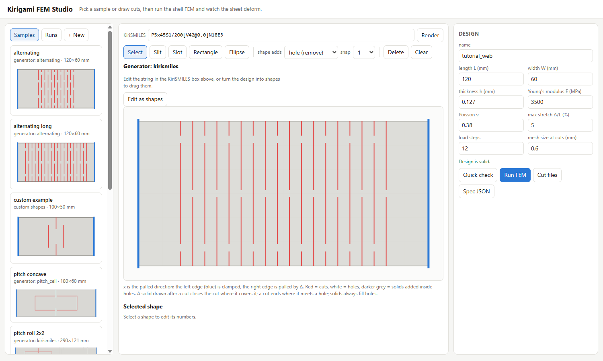
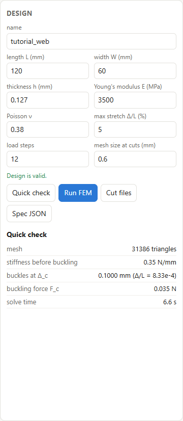
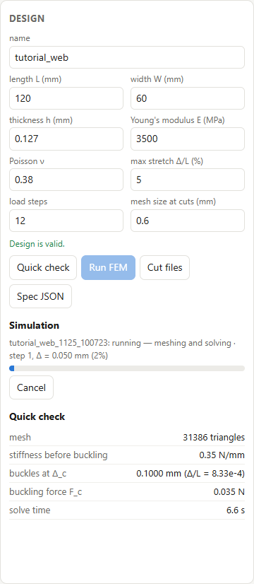
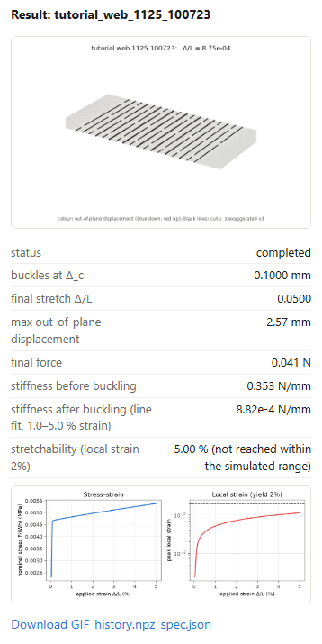

# Tutorial: the web app

This walkthrough stretches the staggered-slit sheet of the [tutorials page](README.md) by 5 %
and reads off its stiffness, all in the browser. The screenshots and numbers below are from a
real run.

**Before you start.** Install the code as in the [README](../README.md#installation), start
Docker Desktop (needed from step 2's Quick check on), and start the web app as described in
[Using the web app](../README.md#using-the-web-app):

```
.venv\Scripts\python webapp\server.py        (Windows)
.venv/bin/python webapp/server.py            (macOS, Linux)
```

Then open **http://localhost:8000**. The page has three columns: samples and past runs on the
left, the design in the middle, and its settings, checks and results on the right.

## 1. Describe the design

1. Click **+ New** (top left) for an empty sheet.
2. Click in the **KiriSMILES** box above the canvas and type

   ```
   P5x45S1/2O0[V42@0,0]N18E3
   ```

   The pattern is drawn as you type. (You could instead draw slits with the **Slit** tool; the
   box then shows the string of your drawing.)
3. Fill in the **Design** form on the right:

   | Field | Value | Meaning |
   |---|---|---|
   | name | `tutorial_web` | the run's name; results go to `results/runs/<name>_<date>_<time>/`, here `tutorial_web_1125_100723` |
   | length L, width W | 120, 60 | the sheet in mm; it is pulled along L |
   | thickness h | 0.127 | mm |
   | Young's modulus E | 3500 | MPa (PET) |
   | Poisson ν | 0.38 | |
   | max stretch Δ/L | 5 | percent: the right end is pulled by 6 mm |
   | load steps | 12 | |
   | mesh size at cuts | 0.6 | mm; smaller is finer and slower |

   The sheet is clamped: the left end is held and the right end is pulled, and neither end can
   rotate, as in a tensile tester. The blue lines on the canvas mark the two ends.



## 2. Check it

The design is checked as you edit: the line under the form says **Design is valid.**, or what
is wrong (for example, two slits that cross).

Click **Quick check** (about 15 s). It meshes the sheet and computes how stiff the sheet is
before it buckles, and how far it can be pulled before it buckles out of plane (Δ_c):



| Quick check | Value |
|---|---|
| mesh | 31,386 triangles |
| stiffness before buckling | 0.35 N/mm |
| buckles at Δ_c | 0.1000 mm (Δ/L = 8.33e-4) |
| buckling force F_c | 0.035 N |

The sheet buckles after only 0.1 mm of the 6 mm pull: almost the whole test happens in the
buckled state, which the full simulation follows.

## 3. Simulate

Click **Run FEM**. The job is queued and starts at once if no other simulation is running;
simulations run one at a time.

## 4. Follow it

A progress bar appears under the buttons, with the current load step and stretch:



The bar moves slowly at first, at the buckling point, and faster after it. This run took
12 minutes for its 13 steps.

You can keep editing other designs meanwhile. **Cancel** stops the run. The full solver
output is written to `log.txt` in the run's folder, `results/runs/tutorial_web…/`.

## 5. Analyse

When the run finishes, the result panel shows the deformation as an animation, the key
numbers, and the stress–strain curve:



**The stiffness.**

The table lists both stiffnesses, each fitted to the simulated force:

| Result | Value |
|---|---|
| stiffness before buckling | 0.353 N/mm |
| stiffness after buckling (line fit, 1–5 % strain) | 8.82e-4 N/mm |
| buckles at Δ_c | 0.1000 mm |
| max out-of-plane displacement | 2.57 mm |
| final force | 0.041 N |

- Before buckling the sheet is a stiff spring, 0.353 N/mm, as the Quick check predicted.
- At Δ_c = 0.1 mm the ligaments between the slits buckle out of plane and the force stops
  rising: the steep line at the start of the stress–strain plot turns almost flat.
- After buckling the sheet is about 400 times softer, 0.00088 N/mm: the pull mostly rotates
  the ligaments out of plane instead of stretching them.

The **stretchability** is the strain at which the material itself would start to yield (local
strain 2 %, for PET). It is not reached within the 5 % simulated, so the sheet stays elastic.

The [command line tutorial](command_line.md#5-analyse) shows the same fit as a plot, with a
script you can run on any run's `history.npz`.

**Later.** The **Runs** tab (top left) lists every finished run, with its animation; click one
to show its animation and key numbers again (the fitted stiffnesses are shown when a run
finishes; for a stored run, use the script of the command line tutorial). The links under the result download the GIF, the full history
(`history.npz`) and the spec, which runs the same design from the
[command line](command_line.md).
